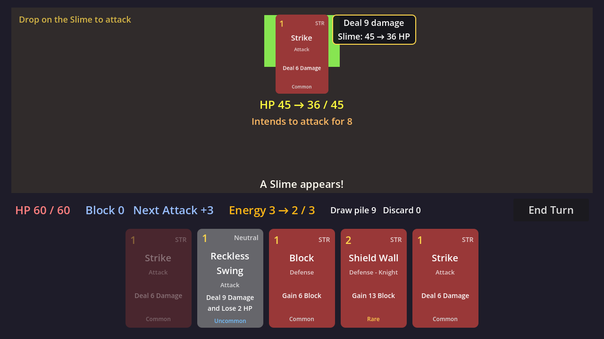
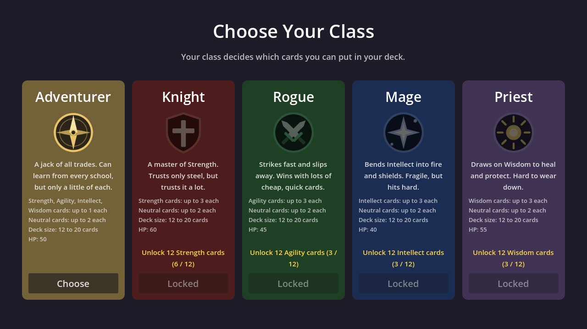
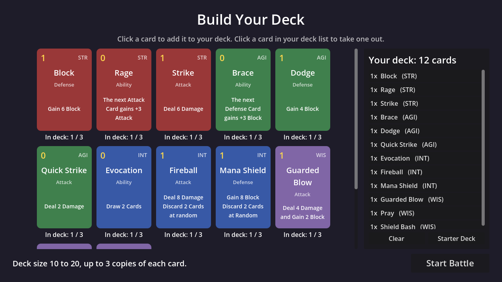

# Card Game

A tiny deckbuilder in the style of *Slay the Spire*, made with **Godot 4.7** and
**GDScript**. It's deliberately small so every line can be read and understood.







**What's in it so far**

- A **Character Select** screen: each class (Adventurer, Knight) has its own deck-building rules
- A **deck builder** before each battle: pick which cards (and how many copies) go in your deck
- 22 cards: four schools (Strength, Agility, Intellect, Wisdom), Neutral cards, and class-only cards, made from a
  spreadsheet: `data/cards.csv` (see [Making cards from the spreadsheet](#making-cards-from-the-spreadsheet))
- Draw 5 cards each turn, with a draw pile and discard pile that reshuffles when empty
- 3 **energy** per turn; cards you can't afford are greyed out
- Fights against one or several enemies, each showing what it **intends** to do next turn: attack, block, buff, shield its friends, heal, summon help or split in two
- A boss at the end of each area: beat the Plains' Slime King to open the Forest
- Block that soaks up damage and disappears at the start of your next turn
- A turn loop (your turn, then the enemy's), plus a Victory / Defeat screen with Play Again and Change Deck buttons

---

## 1. Get the code onto your computer

Pick **one** of these. GitHub Desktop is recommended because it makes it easy
to get updates and save your own changes later.

### Option A: GitHub Desktop (recommended)

1. Download and install [GitHub Desktop](https://desktop.github.com/), then sign in with your GitHub account.
2. Choose **File → Clone repository...**
3. On the **GitHub.com** tab, pick `DustyOBrien/card-game`.
4. Leave the **Local path** as it is (usually `Documents\GitHub\card-game`) and click **Clone**.

Later, whenever new code is added on GitHub, click **Fetch origin** and then
**Pull origin** in GitHub Desktop to download it.

### Option B: Download ZIP (quickest, no extra software)

1. Go to the repo page on GitHub.
2. Click the green **Code** button, then **Download ZIP**.
3. Right-click the downloaded ZIP and choose **Extract All...**. Put the folder somewhere easy, like `Documents\card-game`.

With this option you won't get updates automatically; you'd download a fresh ZIP each time.

## 2. Open it in Godot

1. Start Godot. You'll see the **Project Manager** (the list of projects).
2. Click **Import**.
3. Browse to the `card-game` folder and select the `project.godot` file inside it.
4. Click **Import** (or **Import & Edit**). The editor opens.
5. Press **F5** (or the ▶ Play button at the top right) to play.

The first time you open the project, Godot creates a hidden `.godot` folder.
That's a cache that Godot can always rebuild, so it isn't saved to GitHub
(see `.gitignore`).

## 3. How to play

The game starts on **Character Select**. Your class decides which cards you can use:

Every class can use **up to 3 copies of any card**. What changes is the class's
deck rule:

| Class | HP | Can use | Extra rule | Unlocks when |
|---|---|---|---|---|
| Adventurer | 25 | Neutral and Adventurer cards. **Talents** open up the schools (Jack of All Trades: 1 card from each school) | School cards only through talents | Unlocked from the start |
| Knight | 30 | Strength, Neutral, Knight cards | - | You own 12 different Strength cards |
| Rogue | 22 | Agility, Neutral, Rogue cards | - | You own 12 different Agility cards |
| Mage | 20 | Intellect, Neutral, Mage cards | - | You own 12 different Intellect cards |
| Priest | 28 | Wisdom, Neutral, Priest cards | - | You own 12 different Wisdom cards |

Every deck needs 12 to 20 cards. A class's unlock counts the different cards
of that school you **own** (see "Your card collection" below). A locked class shows its progress, e.g.
"Unlock 12 Strength cards (6 / 12)". In the deck builder, the line under
**Your deck** counts your cards per school (`STR 3   AGI 2 ...`).

Class-only cards say so on their type line, e.g. **Attack - Knight**.

Then you're on the **deck builder**, holding your class's starter deck:

- Click a card on the left to add a copy to your deck. Click a row in **Your Deck** on the right to take one copy out.
- The dots under each card are its copies: **gold** = in your deck, **grey** = owned but not in it, **hollow** = not owned yet. They always show every copy you own, even when your class can only use fewer (the Adventurer's school cards say "In deck (max 1)"). The line under them shows the card's level and Exp, or why you can't add it ("Deck is full", "1 Strength card max", "Needs talent: Jack of All Trades").
- The tabs at the top right (**All 8**, **Strength 0**...) show one school at a time, with how many of your cards are in each. **Sort by** orders the cards by School, Cost, Name or Rarity.
- Your class's level and Exp bar are under its name.
- **Your Deck** shows a size bar (red until the deck is big enough), your cards per school, a **cost curve** (how many cards cost 0, 1, 2 and 3+), and how many Attack / Defense / Ability cards you have.
- **Clear** empties the deck; **Starter Deck** puts back the suggested deck (each card times its Copies number, but never more than your class allows).
- When the deck is big enough, click **To Town** (it saves the deck). From town, the road leads to the map. **Change Class** goes back to Character Select.
- The first time you open it, a **Guide** walks you round the screen: it dims
  everything except one part, draws a glowing gold box round it, and explains it
  (`scripts/screen_guide.gd`, 6 steps in `start_guide()` in `deck_builder.gd`).
  Each guide shows once (`GameState.seen_guides`, saved); **Skip guide** ends it.

**The map.** Pick where your run happens. The **Plains** are open from the
start. The **Forest** opens once you beat the Plains boss (finish a run there),
and the **Cave** is still locked. Locked areas are greyed out with a padlock
and say what opens them. Cleared areas say "Cleared ✓", and you can go back.
**Edit Deck** goes back to the deck builder.

Cards show **symbols** instead of rules text, so you can read them at a glance:

| Symbol | Means |
|---|---|
|  sword | Damage to the enemy: a number or dice. `d3 x2` = two hits of d3 |
|  shield | Block you gain |
|  card + arrow | Cards you draw |
|  card + cross | Random cards you discard from your hand |
|  heart | HP you heal |

Effects without a symbol (Rage's "Next Attack +3", "+1 Energy", "Lose 2 HP"...)
are still written as a few words. The spreadsheet's Description column is
still used for the tooltip on rows in **Your Deck**.

In the battle:

- Point at a card in your hand to zoom in on it.
- **Drag** a card up out of your hand and let go above it to play it. With one enemy, attacks can be dropped anywhere above your hand too: the enemy lights up to show it will be hit. With several, drop an attack on the enemy you want to hit (see below). It costs energy (the yellow number in its corner).
- While you drag, a banner over the card says what it will do (with bonuses like Rage counted), and the numbers it would change turn gold. Let go over your hand to change your mind.
- The enemy has a **health bar** (its Block shows as a blue shield on the left). While you drag an attack, the bar shows the damage: the **bright, blinking** part is HP it will surely take, and the **striped** part is HP it might take, depending on the dice (`20 → 14–19`). When a hit lands, the lost part flashes yellow and shrinks away.
- **Cards roll dice** for their Attack, Block and Heal (`d3`, `d6`...), and they roll **when you draw them**: cards are dealt one at a time and their little dice tumble right on the card, then stay there so you can plan your turn. A d3 is a triangle and a d6 a square, and a gold die is a Critical (a bonus like Master of None's +1 lights up the dice it turns into crits). When you play the card, the **dice tray** on the left shows the roll with its bonus and total. The dice stay up until your next card or End Turn.
- **Wild** cards (marked *Wild* at the bottom) are the gamble: they DON'T roll when drawn. Their dice tumble in the dice tray when you play them, so you don't know what you'll get. The drag banner shows their range (`Deal 1–6 damage`).
- The **Battle Log** on the right lists everything that happens: each turn, the cards you draw and play, every roll, damage, Block and Heal. **Copy** puts the whole log on your clipboard, handy for pasting a game into a note when you test cards.
- **Advantage / Disadvantage:** roll each die twice and keep the higher (Advantage) or the lower (Disadvantage). The dice tray shows the die that was thrown away, small and faded. Having both cancels out. Insight gives your next roll Advantage; if that card already rolled when you drew it, it rolls a second set when you play it and keeps the higher dice.
- **Gamble** asks you to click a card in your hand (one that already rolled, not a Wild one) and rolls its dice again.
- **Criticals:** a die that lands on its top number (a 3 on a d3, a 6 on a d6) is a **Critical**, and the card's Crit effect happens (e.g. "Crit: Draw 1"). Bonuses count: with Master of None's +1, a 2 on a d3 becomes 3, which is a crit. Every die checks on its own, so Multi Strike (two d3s) can crit twice.
- **Armor** saves leftover Block, and it's part of your class (the Adventurer has 3). Normally your Block drops to 0 at the start of your turn. With Armor 3, up to 3 of it stays: gain 10 Block, take a 5 hit, and the 5 left over becomes 3 next turn (2 left over would stay 2). Armor never gives you Block on its own. It's shown next to your Block: `Block 5  (Armor 3)`. Change a class's Armor in its `.tres` file in `classes/`. Enemies can have Armor too: click an enemy in `enemies/` and set **Armor** in the Inspector (the Slime has 0).
- **Vanish** cards (marked *Vanish* at the bottom) disappear once you play them, for the rest of the run: they don't go to the discard pile, and they're left out of the next fights too. A new run brings them back. This stops healing cards from being played over and over.
- **Flawless** cards (marked *Flawless*) crit on every die, whatever they roll. The Pack Rat spec makes the FIRST play of each card in a fight Flawless too.
- **Empowered** cards roll every die one size bigger: d3 → d6 → d8 → d10 → d12 → d20 (the top). Bigger dice hit harder, but a crit still needs the top number, so they crit less often.
- When you're out of energy or cards, click **End Turn**.
- **Several enemies:** a fight can have up to three enemies side by side, each with its own health bar and attack. To hit one with an attack, **drop the card on that enemy** (it lights up). With only one enemy left, you can drop attacks anywhere.
- **AoE and Random attacks:** a card's **Target** decides who it hits. **AoE** cards (marked *AoE*, like Sweep) hit **every** enemy, and **Random** cards send each hit to a random enemy. Drop them anywhere. While you drag, the health bars of the enemies it would hit show the damage.
- A single-target card only ever hits the enemy you dropped it on. If Multi Strike's first hit defeats it, the second hit is wasted (like in Slay the Spire). Right between two enemies, the nearer one is the target, and only that one lights up.
- The enemies then take their turns, left to right, doing what their **intent** (the coloured line under their health bar) said:
  - red **Attack 4** (or **Attack 3 x2** for two hits). Your Block absorbs damage first.
  - blue **Block 6**, or **Shield allies 3** (Block for the other enemies).
  - gold **Strength +1** (all its attacks hit 1 harder for the rest of the fight), or **All Strength +1** for every enemy.
  - purple **Summon Slimeling**: calls in more enemies (never more than 4 standing).
  - green **Split!**: a splitting enemy (the Big Slime) that's down to half HP turns into 2 smaller ones on its turn, each with the HP it had left.
- An enemy's **Strength** and **Armor** show on a second line under its intent.
- Defeat every enemy to win. Each one drops **1 to 5 gold** (bosses drop extra).

**The dungeon.** Picking an area starts a run in its dungeon: a **5 × 5 grid**
of squares, and you start in the middle. Every other square is hidden.

- Click a **?** square next to where you've been to explore it. That draws a
  card from the area's **room deck**, and the square becomes that room: a
  **Fight**, a **Hard Fight**, a **Locked Chest**, a **Treasure**, a
  **Campfire**, the **Mini Boss**, or an **Empty** room.
- **Fight or Back off.** When you find a fight, you see the enemies first and
  choose: **Fight**, or **Back off** to the square you came from (1 step). The room
  stays on the map and blocks the way until you beat it, so you can come back
  for it later (the Mini Boss and the Boss too).
- **Ambush** rooms (marked in the sheet) start the fight straight away: no backing off.
- You can walk back through rooms you've cleared for free (click any explored
  room), but you can't walk through a fight you haven't won.
- **Hover** any square for a moment to see what it is (enemies, loot, what a
  Mini Boss opens), and hover the side panel for what HP, Keys, Danger and Found mean.
- **Danger.** Every step makes noise: every **6 steps** since your last rest,
  every enemy gets **+1 Strength**. The side panel shows how many steps until it
  goes up again, and hovering a square shows how far it is.
- **Keys and chests.** Fights drop a **small key** 25% of the time. A key opens one
  Locked Chest (gold, a card, a pack, or a **Map**). A Map unlocks a new room card
  for that area for good, so the area gets richer the more you play it.
- **Campfires** (for now) only take you home: **Return to Town**, keeping
  everything you found. **Not now** keeps exploring. (The old Rest, which healed
  and reshuffled the map, is still in `DungeonRun.rest()` for later.)
- **The Mini Boss.** Beating it lights a campfire where it fell. Its campfire
  also has **Go Deeper** (now, or later with **Not now**): it adds the next
  **tier**'s harder (and richer) rooms to the deck and reshuffles the map, but
  doesn't heal. After the last tier's Mini Boss, resting shuffles in the
  **Boss** room instead. The Plains and the Forest have **3 tiers**. Beating the
  final Boss shows the **Victory** screen and opens the next area on the map.
- **Events.** A **Mystery** room is a little story with choices: a strange
  fountain, a wandering merchant (spend found gold on potions, enchants, keys),
  an ancient altar... Some choices are a gamble (they show their % chance), and
  some cost found gold (greyed out if you can't pay). Events come from
  `data/dungeons/events.csv`.
- **Super cards.** Very rare, very strong cards (orange glow, "★ Super"). A Mini
  Boss drops one 25% of the time, and some events and Tier 3 chests give them.
  They join your deck for **this run only** and are gone when it ends. They come
  from `data/super_cards.csv` (same columns as cards.csv, Rarity = Super).
- Gold, cards and packs you find are only **yours once you get out**: Leave at a
  campfire or beat the Boss. Die, and the dungeon keeps them (you keep your Exp),
  except what's in your **Save Sack**.
- **Save Sack.** The side panel lists what you've Found as little buttons. Drag one
  into a Save Sack slot (or click it) and it's safe even if you die; click a slot
  to take it back out. You start with **2 slots**; a slot holds a pack, a card, or
  up to **5 gold**. The Tailor in town adds slots and gold.
- **Enchants.** Fights sometimes drop an enchant (35% for a Fight, 60% Hard Fight,
  always for a Mini Boss). Press **Use Enchant** and click a card in your deck: it
  gets the enchant **for this run** (one per card). Enchanted cards say
  "Enchant: Sharpened" at the bottom.
- **Potions.** Fights sometimes drop a potion (25% / 35% / 50%). You can carry 3. In a
  fight, click one (bottom left) to drink it: heal, Block, Energy, draw, damage...
- **Your flask.** You take ONE flask into each run (pick it with the Flask button in
  town). It's like a potion you never lose: it has charges (1 to start), you drink it
  from the bottle at the bottom-left of a fight (a healing flask can also be drunk on
  the dungeon map: click it in the side panel). Its charges refill at the start of every run.
  The **Health Flask** (heal d3) is yours from the start; the **Energy Flask** (+1
  Energy) is unlocked for gold. Both are upgraded at the Alchemist (bigger die, more
  charges, +roll, 2 Energy, a chance to keep the charge).
- If the room deck runs out, the other squares become dead ends.

Your HP carries over from one fight to the next (the top of the battle screen
shows `Plains · Tier 1 · Danger 0`). After a win, **Back to the Dungeon** returns
to the grid. When the run ends (Boss beaten, Leave, or death) you go back to **Town**.

**How a new game starts.** You're the one rebuilding the town, so there's no
fighting at first: Character Select and the Deck Builder stay hidden.

1. **A Town of Your Own** (the King): his letter gives you 5 Stone and the
   **Guild Hall** blueprint. Build it: its **Bank** keeps what you bring home.
2. **Stone for the Inn**: a scripted trip to the Plains with no monsters. 5 Stone
   in all: 1 each on two Stone Piles, plus a Small Chest (1) and a Medium Chest (2),
   opened with the 2 keys you find. A Guide box explains each new thing (with
   "Stone 3 / 5" progress). The campfire's only choice is **Return to Town**,
   greyed out until you have the Stone. Then build the **Inn**.
   Finding a key or a chest, and unlocking a chest, are animated.
3. The Inn brings the first **Adventurer** (a big unlock banner). Character
   Select and the Deck Builder open, and the Adventurer's training starts, three
   fights against dummies (`scripts/tutorial.gd`). A "NEW THIS TURN" box explains
   each new thing as it shows up:
   - **Attack**: only Strikes. Dice roll when drawn, and a die that rolls its top
     number is a **crit** (one Strike is rigged to really roll a 3). Turn 2 draws
     Punch (Strength), Kick (Agility) and Reroll: **schools** and **rerolls**.
   - **Block**: turn 1 is only Full Guards (**Wild**: rolls when played).
     Turn 2 brings Master of None (+1 to the next roll) and Fortify (d6 Block;
     a crit gives +1 **Armor**). The rigged Fortify rolls a 5, and Master of
     None's +1 makes it a crit.
   - **Heal**: Bandage and Insight (**Advantage**: roll twice, keep the best),
     and **Vanish**.
   Then a **NEW CARDS UNLOCKED!** splash gives you your first cards (the
   Unlocked cards, see below), you pick a **Spec** (a Guide first explains what specs are; only Jack of
   All Trades is open, the others show 🔒 Locked), and the Deck Builder's Guide explains the
   screen. **Skip Tutorial** jumps to the splash, and Character Select's
   **Tutorial** button replays the fights.
4. **Clear the Slimes**: bring home 5 Green Ooze (Green Slimes drop it). Gives the
   Alchemist blueprint and adds the Blue Slime rooms to the Plains.
5. **Make your first Flask**: build the Alchemist (5 Green Ooze), then brew the
   Health Flask there (3 Green Ooze). Gives the Shop blueprint.
6. **Slay the Slime Nest**: puts the Big Slime Nest (the Tier 1 boss room) into
   the Plains deck for good. Beat it and Go Deeper at its campfire to reach Tier 2.
   Handing it in unlocks **Talents**, with a banner explaining them.

**Several quests run at once**: the **Story** quest above, plus **Adventurer**
quests and **Side** quests that start when the Adventurer arrives:
- **Open Plains Packs** (Adventurer): open 10 Plains Booster Packs (any size).
  Unlocks the **Pack Rat** spec, with a big "NEW SPEC UNLOCKED!" banner.
- **Kill Enemies 1 / 2 / 3** (Side): defeat 10, then 20, then 30 enemies of any
  kind (the training dummies don't count). Rewards: 1 Small, 2 Medium, then 1
  Large Plains Booster Pack.

**Click the Inn** (or its **Quests** button) for the quest screen: every quest
you're on, grouped Story / Adventurer / Side, each with its objective, a
progress bar, its reward and its story. Finished ones go to the top under
**Ready to Hand In!** with a **Hand In** button. A new quest's story pops up
once, when it starts. Before the Inn exists, the King's quests are on the
**The King's Letter** button at the bottom of town.

**Materials** drop from enemies and turn up in rooms: Stone is the Plains'
building material, Green Ooze comes from Green Slimes, and Lumber from the
Forest's trees. Like gold, they're only yours once you get home; put them in the
Save Sack to keep them if you die. The **Guild Hall**'s **Bank** shows them all.

The other buildings, once you have their blueprint (hover the button to see what
the next stage does):

- **Shop**: booster packs. Stage 2: packs cost 1 less.
- **Tailor**: a bigger Save Sack (+1 slot, then 10 more gold per slot, then +1 slot).
- **Enchanter**: buy a random enchant (15 gold) to take into your next run.
  Stage 2: when an enchant drops, choose from 2.
- **Alchemist**: brew flasks, and buy a random potion (8 gold) for your next run. Stage 2: carry 1 more.
- **Mapmaker**: buy a map (25 gold) that unlocks a new room card. Stage 2: danger
  rises every 8 steps instead of 6.

The Tailor, Enchanter and Mapmaker have no quest giving their blueprints yet.

What you buy for your next run is listed at the bottom of the town. The **road**
at the bottom-right, with its **To the Map** signpost (`town_road.gd`, drawn with
code), goes to the map; the map also has a **Town** button. the gold **Open Packs (n)** button (a booster pack icon)
opens your booster packs, even before the Shop is built (then nothing is for sale).

In the **Shop**:
- Buy **Plains Booster Packs** with gold AND Plains **Stone** from your Bank, so you farm the Plains for them: **Small** (3 cards, 5 gold + 1 Stone), **Medium** (5 cards, 8 gold + 2 Stone) or **Large** (7 cards, 11 gold + 3 Stone). Quests and chests give them too (a chest's Pack is a Small one). They wait under "Your packs" until you press **Open**, which shows the cards one by one, marked **NEW!**, "Owned 2 / 3", or "Extra! Owned 4" for copies past 3.
- Each card in a pack is **Common 60%, Uncommon 30%, Rare 10%**, picked from every card in the game (locked ones too), even ones you already own 3 of. (Odds: `PACK_ODDS`, and the packs' names, sizes and prices: `PACKS`, both in `game_state.gd`.)
- **Back to Town** returns to the town. A new run starts at full HP, and your unspent gold is kept.

**Your card collection.** At the end of the training you get every card marked
**Unlocked** in the spreadsheet, as many copies as its **Copies** column
(`GameState.give_starter_cards()`): 3 Strike, 3 Full Guard, 3 Bandage, Reroll,
Master of None, Punch, Kick, Fortify and Insight;
every other card has to come from a booster pack. You can own up to **3** of a
card. The deck builder only shows cards you own, and a deck can't hold more
copies than you own (or than your class allows). The whole collection is shared
by every class. It lives in `GameState.collection`.

**Saving.** Your gold, collection, card Exp, class Exp, unopened packs and the
last deck you built for each class are saved to `user://save.json` (on
Windows: `%APPDATA%\Godot\app_userdata\Card Game\`; in the editor,
**Project > Open User Data Folder**). It saves when you win a fight, buy or
open a pack, leave the deck builder, and close the game. A run in progress
isn't saved: quit mid-run and you start a new run next time. Room cards you
unlock with Maps are saved. To start over,
press **Reset Save** in the top corner of Character Select. The code is under
"Saving" in `game_state.gd`.

**Card Exp.** Opening a card you already own 3 of gives that card **1 Exp**.
**3 Exp** makes it **Level 2**, and **5 more** (8 in total) makes it **Level 3**.
The level counts for every copy, and leveled cards say so ("Common · Lv 2").
What a level does comes from the level sheets (see "Card levels" below).
The numbers are `CARD_LEVEL_EXP` in `game_state.gd`.

**Class Exp.** Your class gets **10 Exp** for every enemy you beat and **25** more for
finishing a run. Level 2 needs 100 Exp, and each level after needs 50 more
(150, 200...), up to **level 25**. Each class levels up on its own, and leveling
up is how a class gets its **class cards** (see "Class cards" below). The Exp bar
fills up on the victory screen and shows on Character Select and in the deck
builder. Each enemy gives its own Exp (the **Exp** column in `data/enemies/enemies.csv`:
10 for most, more for bosses). The other numbers are at the top of `game_state.gd` (
`EXP_PER_RUN`, `FIRST_LEVEL_EXP`, `LEVEL_EXP_STEP`, `CLASS_MAX_LEVEL`).

Gold amounts and pack prices live at the top of `game_state.gd` (`GOLD_MIN`,
`GOLD_MAX`) and in `PACKS` in `shop.gd`. The dungeon's numbers (grid size, steps
per danger, key chance, rest heal) are at the top of `dungeon_run.gd`.

---

## How the project is organized

```
card-game/
├── project.godot        Project settings (name, window size, which scene starts first)
├── scenes/
│   ├── character_select.tscn The first screen: pick a class
│   ├── deck_builder.tscn Pick the cards for your deck
│   ├── map.tscn         Pick an area (Plains, Forest, Cave) to start a run
│   ├── dungeon.tscn     The 5 x 5 grid you explore between fights
│   ├── battle.tscn      The fight: enemy, player stats, hand, End Turn button
│   ├── town.tscn        Between runs: restore buildings, buy enchants, potions and maps
│   ├── shop.tscn        The Shop in town: spend gold on booster packs
│   └── card.tscn        What ONE card looks like
├── scripts/
│   ├── game_state.gd    Autoload: keeps your class, deck, gold and run while scenes change
│   ├── character_class.gd Defines what a class is (its deck rules)
│   ├── character_select.gd Shows one panel per class
│   ├── area.gd          Defines what an area is (name, picture, background, map spot)
│   ├── map.gd           Puts a button on the map for every area
│   ├── dungeon.gd       Draws the dungeon grid and handles clicks and popups
│   ├── dungeon_run.gd   The dungeon's rules: room deck, danger, keys, resting, loot
│   ├── room_card.gd     One room card (a row of rooms.csv)
│   ├── deck_builder.gd  Adding and removing cards, filters, deck stats
│   ├── battle.gd        The rules: drawing, energy, turns, winning and losing
│   ├── card.gd          Makes a card show its data; clicked (deck builder) or dragged (battle)
│   ├── play_zone.gd     The area above your hand where you drop cards to play them
│   ├── card_data.gd     Defines what information a card has (name, cost, damage...)
│   ├── combatant.gd     HP and Block for the player and the enemy
│   ├── dice.gd          Reads dice formulas like "2d6+1" and rolls them
│   ├── card_roller.gd   The dice rules: modifiers, crits, hits, totals
│   ├── die_view.gd      One die on screen, drawn with code (_draw)
│   ├── health_bar.gd    The enemy's health bar and damage preview, drawn with code
│   ├── dice_tray.gd     The panel where dice tumble and land
│   ├── battle_log.gd    The Battle Log panel (a RichTextLabel)
│   ├── town.gd          The town: building panels, restoring, buying
│   ├── town_building.gd One building (a row group of town.csv)
│   ├── town_road.gd     The road out of town, with its "To the Map" sign
│   ├── quest.gd         One quest (a row of quests.csv)
│   ├── unlock_banner.gd The big "You unlocked something!" banner
│   ├── screen_guide.gd  The step-by-step Guide round a screen (spec screen, deck builder)
│   ├── material_info.gd One material (a row of materials.csv)
│   ├── tutorial.gd      The three training-dummy fights
│   ├── enchant.gd       An enchant, and how it changes a card in a fight
│   ├── potion.gd        A potion you drink in a fight
│   ├── flask.gd         Your flask: charges, upgrades (flasks.csv)
│   ├── dungeon_event.gd An event with choices (events.csv)
│   ├── victory.gd       The WIN screen after a final Boss
│   ├── shop.gd          The shop: pack list, buying, opening packs
│   └── card_importer.gd Turns the spreadsheet into card files
├── tools/
│   └── import_cards.gd  Run this in the editor to re-import the spreadsheet
├── data/
│   ├── cards.csv        The card spreadsheet (the master list of cards)
│   └── dungeons/rooms.csv  Each area's room deck
├── cards/               One .tres file per card, made by the importer
├── classes/             One .tres file per class (adventurer, knight, rogue, mage, priest)
├── areas/               One .tres file per area on the map (plains, forest, cave), with its room deck
├── enemies/             One .tres file per kind of enemy (made from data/enemies/*.csv)
├── art/                 Pictures (SVG): backgrounds/, enemies/ (Slimes, Wolf, Mushroom, Old Oak), areas/ (map icons), map/
├── emblems/             The class emblems (SVG pictures)
├── icons/               Card symbols: attack, block, draw, discard, heal (SVG)
├── themes/              main_theme.tres: how buttons and panels look everywhere
└── docs/                Pictures for this README (Godot ignores this folder)
```

You may also see `.uid` and `.import` files. Godot makes these automatically
to keep track of files. Leave them alone and keep them in git.

## The four big ideas in Godot

### Nodes

A **node** is one building block that does one job. A `Label` shows text. A
`Button` can be clicked. An `HBoxContainer` lines up its children side by side.
A plain `Node` does nothing on its own, but you can give it a script.

Nodes are arranged in a **tree**: each node can have children. Open
`scenes/battle.tscn` and look at the **Scene** panel (top left) to see it:

```
Battle (Control)                 ← battle.gd is attached here
├── Player (Node)                ← combatant.gd: your HP and Block
├── Background (ColorRect)        ← plain colour, in case an area has no picture
├── AreaBackground (TextureRect)  ← the area's picture (the Plains)
├── Margin (MarginContainer)
│   └── Layout (VBoxContainer)   ← stacks everything top to bottom
│       ├── EnemyBox             ← "Plains · Fight 2 / 5", then EnemyRow: one
│       │                          EnemyView (enemy_view.gd) per enemy, made in code
│       ├── Spacer
│       ├── MessageLabel
│       ├── PlayerBar            ← HP, Block, Energy, piles, End Turn
│       └── Hand (HBoxContainer) ← cards get added here while playing
└── GameOverScreen               ← hidden until someone wins
```

### Scenes

A **scene** is a tree of nodes saved as a file (`.tscn`). Scenes can be used
inside other scenes, like a blueprint you can stamp out many times.

`card.tscn` is the blueprint for a single card. The battle script makes a
new copy of it for every card in your hand:

```gdscript
var card: Card = CARD_SCENE.instantiate()  # build a new card from the blueprint
hand_box.add_child(card)                   # put it in the Hand row
```

Double-click `card.tscn` in the **FileSystem** panel (bottom left) to open
and edit it on its own.

### Scripts

A **script** (`.gd` file) adds behaviour to a node. The first lines say what
kind of node it's for, e.g. `extends Button`. That's like inheriting from a
class in Python: the script *is* a Button, plus whatever we add.

Godot calls some functions for you automatically. The main one here is
`_ready()`, which runs once when the node appears. It's a lot like Python's
`__init__`.

### Signals

A **signal** is an announcement: "something just happened". Other nodes
**connect** a function to it, and that function runs every time the signal
is **emitted**. The node making the announcement doesn't need to know who's
listening.

This project uses signals in a chain when you play a card:

1. You drag a card and drop it on the play zone (see "Drag and drop" below).
2. `play_zone.gd` emits its `card_dropped` signal, passing along which card it is.
3. `battle.gd` hears `card_dropped`, spends energy, and calls `enemy.take_damage(6)`.
4. `combatant.gd` lowers HP and emits `stats_changed`.
5. `battle.gd` hears `stats_changed` and updates the labels on screen.

Connecting in code looks like this (from `battle.gd`):

```gdscript
player.died.connect(_on_player_died)   # "when the player dies, run _on_player_died"
```

You can also connect signals without code, in the editor's **Node** tab (next
to the Inspector). This project connects them in code so you can see them all
in one place.

### Drag and drop

Godot has drag and drop built into every Control. It's three functions:

| Function | Lives on | Godot asks |
|---|---|---|
| `_get_drag_data()` | the thing you drag (`card.gd`) | "What are you carrying?" Return `null` to refuse (e.g. you can't afford the card). |
| `_can_drop_data()` | the place you drop (`play_zone.gd`) | "Would you take this, if it were dropped right here?" Cards that deal damage only say yes over the enemy. |
| `_drop_data()` | the place you drop (`play_zone.gd`) | "Here it is!" |

`set_drag_preview()` picks what follows the mouse. Ours is a copy of the card
(`duplicate()`) with a banner on top. Every node also gets
`NOTIFICATION_DRAG_BEGIN` and `NOTIFICATION_DRAG_END`, which `battle.gd` uses
to show "Drop here to play" and the gold preview numbers.

The preview and the real thing use the same functions (`get_damage()`,
`get_block()`), so the preview can't disagree with what actually happens.

### Switching scenes, and autoloads

The game has two screens, and each one is its own scene. Moving between them is one line:

```gdscript
get_tree().change_scene_to_file("res://scenes/battle.tscn")
```

That throws the current scene away (and every variable in it!) and loads the
new one. So how does the battle know which deck you built? It's kept in an
**autoload**: a script Godot creates once when the game starts and never throws
away. This project has one, `game_state.gd`, registered under the name
`GameState` in **Project → Project Settings → Globals → Autoload**. Any script
can use it by name:

```gdscript
GameState.deck.append(card)              # deck builder: add a card
draw_pile = GameState.deck.duplicate()   # battle: copy the deck, then shuffle the copy
```

Keep autoloads small: only things that really must outlive a scene belong there
(later: the player's HP between fights, gold, which floor you're on...).

### Themes: one look for every screen

Instead of styling every button by hand, the project has a **Theme**:
`themes/main_theme.tres`. It says what every `Button`, `PanelContainer`,
`ProgressBar` and scrollbar looks like (colours, rounded corners, borders), and
it's switched on for the whole game in **Project Settings → GUI → Theme → Custom**.
Double-click it in the FileSystem panel to open the **Theme editor** and try
changing a colour: every screen updates at once.

A theme can also have **variations**. `PrimaryButton` is a gold version of
`Button`; the deck builder's **To Town** button uses it by setting
`theme_type_variation` to `PrimaryButton` in the Inspector.

### Bonus idea: Resources and card data

`card_data.gd` defines a **Resource**, which is Godot's name for a piece of
data saved as a file. Each file in `cards/` (like `strike.tres`) is one of them. Click
one in the FileSystem panel and you can change its cost, damage, or colour in
the **Inspector** on the right. (Changes made there are overwritten the next time you import the spreadsheet, so the spreadsheet is the place for lasting changes.)

Every card has these fields:

| Field | What it is |
|---|---|
| Card Name | The name at the top of the card |
| Cost | Energy needed to play it |
| Types | Checkboxes: **Attack** (deals damage), **Defense** (gains Block), **Ability** (other effects, like drawing a card). A card can have several. |
| Schools | Checkboxes: **Strength**, **Agility**, **Intellect**, **Wisdom**. A card can have several, or none (Neutral). Shown as STR / AGI / INT / WIS for now. |
| Attack | A list with one entry per hit, each a number or dice: `["d3", "d3"]` = Multi Strike |
| Attack Modifier | Added to every attack die (d3 + 1) |
| Block | Block the player gains: a number or dice |
| Block Modifier | Added to the block roll |
| Heal | HP the player gets back (can't go above max HP): a number or dice |
| Next Roll Bonus | Added to every die of the next card that rolls (Master of None) |
| Critical | What a Critical does, e.g. `+1 Damage` or `Draw 1, Gain 1 Energy` |
| Draw | Cards the player draws |
| Discard | Random cards thrown from the player's hand into the discard pile |
| Draw If Full HP | Cards drawn only if you were at full HP when you played it (Pray) |
| Next Attack Bonus | Extra damage for your next Attack card (Rage) |
| Next Defense Bonus | Extra Block for your next Defense card (Brace) |
| Copies | How many go in the Starter Deck (a class may allow fewer) |
| Class Only | Which classes may use it, e.g. Knight. Empty = every class |
| Rarity | Common, Uncommon or Rare. Shown at the bottom of the card (grey, blue, gold) |
| Unlocked | Off = the deck builder shows the card as **Locked** and you can't add it |
| Energy | Energy you gain when you play it (Adrenaline) |
| Lose HP | HP you lose when you play it. Block doesn't stop it (Reckless Swing) |
| Wild | On = its dice roll when you play it, not when you draw it |
| AoE / Random | Its attack hits every enemy / a random enemy (the Target column) |
| Vanish | On = gone for the rest of the run once played |
| Effect | The rules text printed on the card (typed by hand) |
| Color | The card's background colour |

Types and Schools use **bit flags**: each option is a power of two (1, 2, 4, 8)
and the card stores them added together, so Attack + Ability is 1 + 4 = 5.
The comments in `card_data.gd` explain this, and the helpers
`has_type()` / `has_school()` do the checking for you:

```gdscript
if card.has_type(CardData.CardType.ATTACK):
	print("This card is an attack!")
```

## How a turn works (in `battle.gd`)

```
start_battle()
  └─ copy the deck you built (GameState.deck), shuffle, then start_player_turn()

start_player_turn()
  ├─ the player's Armor saves up to that much leftover Block, refill energy to 3
  ├─ choose the enemy's next attack (shown as its "intent")
  └─ await draw_cards(5): deal cards one by one, dice cards (not Wild) roll

You drag a card onto the play zone  →  _on_card_played()
  └─ pay energy, roll (Wild) and show the dice, deal damage / gain block,
     then move the card to the discard pile (or Vanish it)

You click End Turn  →  _on_end_turn_pressed()
  ├─ move the rest of your hand to the discard pile
  ├─ enemy_turn(): short pause, then the enemy attacks
  └─ start_player_turn() again (unless someone's HP hit 0)
```

## GDScript for Python people

| Python                       | GDScript                              |
|------------------------------|---------------------------------------|
| `def attack(amount):`        | `func attack(amount: int) -> void:`   |
| `x = 5`                      | `var x := 5`                          |
| `MAX = 3` (by convention)    | `const MAX := 3`                      |
| `None`                       | `null`                                |
| `True` / `False`             | `true` / `false`                      |
| `for i in range(5):`         | `for i in 5:`                         |
| `len(my_list)`               | `my_list.size()`                      |
| `my_list.pop()`              | `my_list.pop_back()`                  |
| `random.shuffle(my_list)`    | `my_list.shuffle()`                   |
| `f"HP {hp}/{max_hp}"`        | `"HP %d / %d" % [hp, max_hp]`         |
| `self.hp`                    | `hp` (`self.` is optional)            |
| `import` a class             | `class_name` makes it available everywhere |

Indentation works just like in Python (this project uses tabs). The `: int`
and `-> void` bits are optional type hints, like Python's. They help Godot
catch mistakes and autocomplete for you.

## Things to try next

Small changes, roughly easiest first:

1. **Tweak numbers.** Change a card's numbers in the spreadsheet and re-import, or the Slime's HP in `data/enemies/enemies.csv`.
2. **Change a class's deck rules.** Click `classes/knight.tres` in the FileSystem panel and change the numbers in the Inspector. Or make a new class (see [Adding a class](#adding-a-class)).
3. **Change an enemy's moves.** Edit its rows in `data/enemies/moves.csv` and re-import.
4. **Make a new card.** Add a row to the spreadsheet and re-import (see below).
5. **Show HP as a bar** using a `ProgressBar` node instead of a label.
6. **Make a new enemy.** Add a row to `enemies.csv`, its moves to `moves.csv`, and put it in a fight room in `data/dungeons/rooms.csv`.
7. **Add a card reward** after winning, so your deck grows: that's the "deckbuilding" part!

## Making cards from the spreadsheet

All cards live in one spreadsheet, `data/cards.csv`. The game doesn't read the
spreadsheet directly; an **importer** turns each row into a card file in `cards/`.

**To change cards:**

1. Edit your spreadsheet and export it as CSV (Google Sheets: **File → Download → Comma-separated values**).
2. Save it over `data/cards.csv` in the project folder (same name).
3. In Godot, double-click `tools/import_cards.gd`, then in the Script editor choose **File → Run** (Ctrl+Shift+X).
4. The **Output** panel at the bottom lists every card it made. Press F5 to play.

**Columns** (the order doesn't matter, and capital letters don't matter):

| Column | Example | Notes |
|---|---|---|
| Name | Multi Strike | Also used for the file name (`multi_strike.tres`) |
| Copies | 2 | How many go in the Starter Deck. A class can allow fewer: the Adventurer's starter deck has no school cards |
| Cost | 1 | |
| School | Neutral | Strength, Agility, Intellect, Wisdom or Neutral. Several allowed, separated by `,` or `/`. Blank = Neutral |
| Type | Attack | Attack, Defense, Ability. Several allowed, like School |
| Class | Adventurer | Only these classes can use the card. Several allowed, like School. Blank = every class |
| Rarity | Rare | Common, Uncommon or Rare. Blank = Common |
| Unlocked | TRUE | TRUE/FALSE or Yes/No. TRUE = you start owning it (as many as Copies). FALSE = you have to find it in a booster pack first (until then it's hidden in the deck builder). Blank = TRUE |
| Description | Deal d3x2 Damage | Hover text in the deck list. **Leave it blank** and it's written for you from the numbers |
| Attack | d3, d3 | A number (`6`) or dice: `d3` = one 3-sided die, `2d6+1` = two 6-sided dice plus 1. Several hits separated by commas: `d3, d3` = two hits, each rolled on its own (Multi Strike) |
| Attack (2) | d3 | A second hit, rolled separately. Attack (3), (4)... work too |
| Hits | 2 | Optional, instead of Attack (2): repeats the Attack this many times |
| Attack Modifier | 1 | Added to every attack die, and counts towards a crit (d3 + 1 crits on a 2 or a 3) |
| Block | d3 | A number or dice, like Attack |
| Block Modifier | 1 | Added to the block roll |
| Heal | d3 | A number or dice, like Attack |
| Heal Modifier | 1 | Added to the heal roll |
| Draw | 2 | Cards drawn |
| Discard | 1 | Random cards discarded from your hand |
| Draw If Full HP | 1 | Cards drawn if you were at full HP. TRUE counts as 1 |
| Next Die Roll Bonus | d3 | Added to every die of the next card you play that rolls. A number, or dice that roll when the card is played (Pump Up) |
| Next Attack Bonus | 3 | Added to every hit of your next Attack card (counts towards crits) |
| Next Defense Bonus | 3 | Added to your next Defense card's Block |
| Energy | 1 | Energy gained |
| Lose HP | 2 | HP lost (Block doesn't stop it) |
| Critical Effect | Draw 1 | What happens for each die that crits. Use these phrases, separated by commas: `+1 Damage`, `+1 Block`, `+1 Heal`, `Draw 1` (or `Draw a Card`), `Gain 1 Energy`, `Gain Advantage`, `Dont Vanish`, `+1 Armor` (Armor for the rest of the fight). Blank or `-` = none. (A column called just **Critical** works too) |
| Wild | TRUE | TRUE = the dice roll when played, not when drawn. (Or a **Roll** column with `Play` / `Draw`.) Blank = FALSE |
| Vanish | TRUE | TRUE = gone for the rest of the run once played. Blank = FALSE |
| Flawless | TRUE | TRUE = every die on the card is a Critical, whatever it rolls. Blank = FALSE |
| Empowered | TRUE | TRUE = every die on the card is one size bigger (d3 → d6 → d8 → d10 → d12 → d20). Blank = FALSE |
| Advantage | TRUE | This card's dice roll with **Advantage**: each die is rolled twice and the higher one is kept |
| Disadvantage | TRUE | This card's dice roll with **Disadvantage**: each die is rolled twice and the lower one is kept (Wild Swing) |
| Target | All | Who an attack hits: **Single** (the enemy you drop it on), **All** (or **AoE**: every enemy) or **Random** (each hit picks a random enemy). Blank = Single |
| Gain Advantage | TRUE | The next card you play that rolls dice gets Advantage (Insight) |
| Reroll | 1 | After playing it, click this many cards in your hand to roll their dice again. Wild cards can't be picked (Gamble) |

Blank cells count as 0 (and FALSE). The "Card" column is ignored (Name is used instead).
If the importer can't read a cell (like a Critical it doesn't know), it prints a
warning in Godot's Output panel and skips that part.

**The spreadsheet is the boss:** any card file in `cards/` that isn't in the
spreadsheet gets deleted when you import. So make new cards by adding rows,
not by duplicating `.tres` files in Godot.

### Card levels: `cards_level2.csv` and `cards_level3.csv`

These two sheets have **exactly the same columns** as `cards.csv`. The easiest
way to make one: copy your card sheet, change the numbers, and save it as
`data/cards_level2.csv` (or `cards_level3.csv`). The **Name** says which card
a row levels up, so it must match a card in `cards.csv`. You only need rows for
cards that change: a card that isn't in the level 2 sheet plays like level 1.
(A level 3 card that isn't in the level 3 sheet uses its level 2 row.)

The importer saves them in `cards/levels/` (e.g. `strike_lv2.tres`). Battles
and the deck builder show the version that matches the card's level.

### Class cards: `class_cards.csv`

One row per card a class gets when it reaches a level:

| Class | Level | Card | Copies |
|---|---|---|---|
| Knight | 2 | Shield Bash | 1 |
| Knight | 5 | Shield Wall | 2 |

- **Class** is the class's name, **Card** is a card's Name from `cards.csv`.
- **Level 1** cards are given right at the start.
- **Copies** is optional (1 if blank). Copies past 3 turn into card Exp.
- Give class cards a **Class** in `cards.csv` (e.g. `Knight`) if only that class
  should use them, and **Unlocked = FALSE** so they don't start in the collection.
  Class cards never come out of booster packs.

The importer saves each class's list into its file in `classes/` (look for
**Level Cards** in the Inspector).

### Talent trees: `data/talents/<class>.csv`

**Specs.** After you choose a class you pick a **spec** on the Spec screen
(change it later with **Change Spec** in the deck builder). A spec is a free,
always-on set of rules for how the class builds its deck. Specs come from
`data/talents/specs.csv`:

| Class | Spec | Description | Effect | School | Amount | Effect 2 | School 2 | Amount 2 |
|---|---|---|---|---|---|---|---|---|
| Adventurer | Pack Rat | Plays huge decks... | Max Deck Size | | 10 | Copy Limit | | 1 | (plus Effect 3: First Play Flawless) |

The **Unlocked** column (after Spec): **No** = the spec shows 🔒 Locked on the
Spec screen and can't be picked yet (for now only Jack of All Trades is open).

Each spec has the talent tree with the same name, and that tree's tab comes
first. Changing spec gives back every talent point. Points can go in any tree
(`SPEC_TREE_ONLY` in `game_state.gd` switches that to "your spec's tree only").
The Talents screen shows your Spec in a gold banner at the top (with a
**Change Spec** button), marks its tree's tab with ★, and says under the tabs
whether the tree on show is your Spec's.

Each class can have talent trees, like World of Warcraft: one sheet per class,
named after the class's file in `classes/` (`adventurer.csv` is the
Adventurer's). The **Tree** column splits a sheet into trees, each with its own
tab on the Talents screen. The Adventurer has three (placeholder talents for
now): **Jack of All Trades** (school cards), **Master of None** (Neutral only)
and **Pack Rat** (huge decks). Points are shared, so spend them in any tree. Every class
level after level 1 gives 1 talent point. Spend them on the **Talents** screen
(the Talents button on Character Select and in the deck builder). When you have
points to spend, the button turns gold, and the victory screen says
"★ Talent point ready!".

| Column | Example | What it does |
|---|---|---|
| Tree | Pack Rat | Which tree (and tab) it's in. Trees appear in the order they first show up. Blank = one tree called "Talents" |
| Talent | Strength Affinity | The name |
| Tier | 3 | The row, 1 = top |
| Column | 1.5 | Left to right. 1.5 sits between 1 and 2 |
| Cost | 1 | Points per rank |
| Max Ranks | 3 | How many times you can spend on it |
| Needs | Jack of All Trades | Talents you need first (comma-separated). A line connects them |
| Needs Any or All | Any | `Any` = one of Needs is enough. Blank = all of them |
| Points in Tree | 5 | Points you must have spent in **this tree** first (WoW's "5 points per row") |
| Tier Unlock | 3 | Points you must have spent in the tier above, in this tree (`3 in Tier 2` works too) |
| Choice Group | Tier 1 Pick | Only one talent per group can be learned |
| Locks Out | Master of None | Learning this stops you learning these |
| Effect | Cost Discount Chance | What it does (the list below). Blank = nothing yet |
| School | Strength | Which cards it works on: a school, `Neutral`, or `All` |
| Amount | 10, 20, 30 | The number at each rank. One number = that much per rank |
| Rules, Rank 1-5 | ... | The text you see when you hover it (add more Rank columns for more ranks) |

The effects the game understands so far (talent.gd):

| Effect | Amount means |
|---|---|
| School Limit | +that many cards of School in the deck. A school the class can't use starts at 0, so this opens it up |
| Energy | +that much Energy every turn |
| Energy If Only Neutral | +that much Energy if every card in your deck is Neutral |
| Cost Discount Chance | % chance a drawn School card costs 1 less this turn (its cost turns green) |
| Draw Damage Chance | % chance a drawn School card deals 1 damage to all enemies |
| Max Deck Size | +that many cards your deck can hold (Pack Rat) |
| Hand Size | +that many cards drawn at the start of each turn |
| Copy Limit | Only that many copies of each card in the deck (Pack Rat: 1) |
| First Play Flawless | The first time you play each card in a fight, it's Flawless (every die crits) |
| First Play Bonus | +that much on every die the first time you play each card in a fight |
| Max HP Per 2 Cards Over 20 | +that much max HP for every 2 cards in your deck above 20 |
| Start Block Per School | Start each fight with that much Block per different school in your deck (Neutral counts) |
| Bonus Gold | +that much gold from every enemy |
| Pack Discount | Booster packs cost that much less (never below 1 gold) |

Talents and specs can have a second effect: **Effect 2**, **School 2**, **Amount 2**, and a third: **Effect 3**, **School 3**, **Amount 3**.

**Reset Talents** on the Talents screen gives every point back (free for now).
Talents are saved with the rest of your progress.

## Dice and Criticals

Three scripts share the work:

- **`dice.gd`** reads a formula. `Dice.parse("2d3+2")` gives 2 dice, 3 sides,
  +2 bonus, and `"6"` gives no dice and a bonus of 6. It uses a **RegEx** (a text
  pattern). Its functions are `static`: you call them on the class itself, like
  functions in a Python module.
- **`card_roller.gd`** is the rules. `CardRoller.roll(card)` rolls the bare dice,
  and `CardRoller.resolve(card, dice, bonuses)` adds the modifiers, checks every
  die for a crit (die + modifiers reaching its top number) and adds up the hits,
  Block, Heal, Draw and Energy. Keeping the rules in one place means the drag
  preview and the real play can never disagree: the preview simply resolves the
  card with every die on 1 (worst case) and every die on top (best case).
- **`battle.gd`** applies the result: one `take_damage()` per hit, Block, Heal,
  then any extra cards to draw.

The dice you see are drawn by **`die_view.gd`** with `_draw()`, Godot's way of
painting shapes and text with code (no picture files): `draw_colored_polygon()`
for the die, `draw_polyline()` for its edge, `draw_string()` for the number.
**`dice_tray.gd`** spins them with `rotation`, and a Tween with `TRANS_BACK`
gives the landing its little bounce. The small dice on cards in your hand are
the same `DieView`, made with `DieView.new(32)` for a 32 pixel die, and
`card.gd`'s `roll_dice()` tumbles them as the card is drawn.

Two Godot ideas show up in `battle.gd`:

- **`await`**: `await dice_tray.play(...)` pauses that function (not the
  whole game) until the dice animation finishes, then carries on and deals the
  damage. `await draw_cards(5)` waits for the cards to be dealt and their dice
  to land. While it waits, `busy` is true so you can't play another card.
- **`duplicate()`**: at the start of a battle every card in the deck is copied.
  Each copy remembers its own roll (`roll_result`), so two Strikes in your hand
  can show different numbers, and the card files on disk never change. Each
  copy is also tagged with `set_meta("deck_index", i)`, its place in your deck,
  so when it Vanishes, `GameState.vanished` knows exactly which card to leave
  out of the next fights.

## Adding a class

Classes are data, just like cards: each one is a `.tres` file in `classes/`,
made from `character_class.gd`. To add one, you don't write any code:

1. In the **FileSystem** panel, right-click `classes/knight.tres` and choose **Duplicate...**. Name it, e.g. `rogue.tres`.
2. Click the new file. In the **Inspector**, change:
   - **Display Name**, **Description**, **Color**, **Max HP**
   - **Emblem**: drag an image onto it from the FileSystem panel. The emblems are simple drawings in `emblems/` (SVG files, which you can edit in a free program like Inkscape, or swap for your own PNGs)
   - **Unlocking**: tick **Starts Unlocked**, or pick the **Unlock School** and **Unlock Card Count**
   - **Sort Order**: where it appears on Character Select (lower = further left)
   - **Deck Rules**: which **Allowed Schools** are ticked, **Allow Neutral**, **Max Copies** (school cards), **Max Copies Neutral**, **Max Cards Per School** (0 = no limit), **Min / Max Deck Size**
3. Press F5. The new class is on Character Select, and its rules text is written for you from those numbers.

To give the new class its own cards, type its **Display Name** in the **Class** column of the spreadsheet and re-import.

## Adding an area

Areas work like classes: one `.tres` file per area in `areas/`, made from
`area.gd`. To change one, click it and edit it in the **Inspector**:

- **Unlocked**: tick it to have the area open from the start (the Plains).
- **Unlock After**: the name of the area whose boss opens this one (the Forest says `Plains`). Cleared areas are saved.
- **Icon**: the round picture on the map. **Background**: the picture behind the fight (the Cave doesn't have one yet, so it would use the plain dark colour).
- **Map Position**: where its centre sits on the map, in pixels (the screen is 1280 × 720).
- **Sort Order**: its place along the road.

To add a new area, duplicate `areas/forest.tres`. The map draws a button for every area file it finds.

### Enemies and fights: `data/enemies/`

Enemies come from two spreadsheets, like cards (which fights they're in is in the room sheet, below). Run `tools/import_cards.gd`
after changing them (it does cards, talents and enemies). The folder has a
`.gdignore` file so Godot doesn't try to import the sheets itself.

**`enemies.csv`**: one row per enemy. It becomes `enemies/<name>.tres`.

| Column | Example | What it means |
|---|---|---|
| Name | Big Slime | The enemy's name |
| HP | 28 | Max HP |
| Armor | 0 | Saves this much leftover Block each turn, like the player's Armor |
| Art | big_slime.svg | Its picture, in `art/enemies/` |
| Width, Height | 190, 143 | How big the picture is drawn, in pixels |
| Name Color | #5fd16a | The colour of its name |
| Move Order | Random | **Random**: picks a move by Weight each turn. **In Order**: move 1, 2, 3, then back to 1 (bosses, so you can learn the pattern) |
| Split Into | Slime | Blank = never splits. Otherwise, at half HP it splits on its turn into Split Count of these, each with the HP it had left |
| Split Count | 2 | How many it splits into |
| Boss | Yes | A boss. Beating it in an area's Boss room opens the areas that Unlock After it |
| Exp | 15 | Class Exp for beating it |
| Bonus Gold | 10 | Gold on top of the usual 1-5 |

**`moves.csv`**: one row per move. An enemy's moves are its rows, in order. A
move can do several things at once: Attack 3 and Block 3 is one move.

| Column | Example | What it means |
|---|---|---|
| Enemy | Slime | Whose move it is (the Name in enemies.csv) |
| Move | Harden | The move's name, shown in the Battle Log |
| Weight | 1 | How often it's picked, compared with the enemy's other moves (2 = twice as often as 1). Random enemies only |
| Max In A Row | 1 | The most times in a row it can be picked. 1 = never twice in a row. Blank = no limit |
| Attack | 2-5 | Damage per hit: a number, or a range. Blank = no attack |
| Hits | 2 | Attacks this many times (each hit goes through your Block) |
| Block | 6 | Block for itself |
| Strength | 1 | +this to all its attacks for the rest of the fight |
| Heal | 4 | HP back for itself |
| Ally Block | 3 | Block for every OTHER enemy |
| Ally Strength | 1 | Strength for every enemy, itself included |
| Summon | Slimeling | Calls in this enemy (never more than 4 enemies standing) |
| Summon Count | 2 | How many it calls in |
| Notes | | Anything you like; the game ignores it |

The pictures are in `art/enemies/`. In battle each enemy "breathes" with a
looping Tween (`set_loops()`), hops when it attacks, flashes red when hit, and
squishes flat when defeated. See `enemy_view.gd`.

### Room decks: `data/dungeons/rooms.csv`

Each area's dungeon draws its rooms from this sheet (one row per room card).
Run `tools/import_cards.gd` after changing it: it saves each area's cards into
`areas/<area>.tres`.

| Column | Example | What it means |
|---|---|---|
| Area | Plains | Which area's deck it goes in |
| Tier | 1 | **1** = in the deck from the start. **2** = shuffled in when you rest after the Tier 1 Mini Boss, and so on. **Boss** = the Boss room, shuffled in after the last tier's Mini Boss |
| Room | Slime Patch | The room's name, shown on the square |
| Type | Fight | **Fight**, **Hard Fight**, **Locked Chest**, **Treasure**, **Campfire**, **Mini Boss**, **Boss**, **Event** (a random event from events.csv) or **Empty** |
| Copies | 6 | How many of this card go in the deck |
| Unlocked | Yes | **No** = it only goes in the deck once you find a **Map** for it in a chest |
| Ambush | Yes | Fights only. **Yes** = the fight starts as soon as you find it (no Back off). Blank = No |
| Encounters | Slime \| Slimeling, Slimeling | Fights only: the enemy groups it can be, split by `\|`. One group is picked at random each time. Enemies in a group are split by commas, left to right |
| Loot | Gold 10-20 \| Card \| Pack \| Map | What you find, split by `\|`; one is picked at random. Chests and Treasure always give one; for fights it's a bonus for winning. Words: **Gold N-M**, **Card**, **Pack** (a Small Plains Booster Pack), **Key**, **Map**, **Enchant**, **Potion**, **Super Card** |
| Notes | | Anything you like; the game ignores it |

### Events: `data/dungeons/events.csv`

One row per **choice**; rows with the same Event are one event (see
`scripts/dungeon_event.gd`). Run `tools/import_cards.gd` after changing it.

| Column | Example | What it means |
|---|---|---|
| Event | Strange Fountain | The event's name (and the popup's title) |
| Area | Any | `Any`, or one area's name (first row only) |
| Min Tier | 1 | Only found in this tier or deeper (first row only) |
| Text | A stone fountain... | The story (first row only) |
| Choice | Drink deeply | The button |
| Chance | 65 | % that the Effect happens; otherwise the Fail Effect does. 100 = always |
| Effect | Heal 8 | What happens, several split by `;`: **Heal N**, **Lose HP N** (never below 1), **Gold N-M**, **Pay N** (costs found gold; greyed out without it), **Key**, **Potion**, **Enchant**, **Card**, **Pack**, **Super Card**, **Flask** (+1 charge), **Danger N**, **Calm** (danger to 0), **Fight Wolf, Wolf** (a fight, no backing off) |
| Fail Effect | Lose HP 4 | What happens when the Chance misses |
| Result / Fail Result | Cool and sweet. | The text shown afterwards |

The dungeon screen is `scenes/dungeon.tscn` + `scripts/dungeon.gd`; the rules
(drawing rooms, danger, resting, loot) are in `scripts/dungeon_run.gd`, kept
apart from the screen like `combatant.gd` is from the battle. The room pictures
are in `art/rooms/`.

### Enchants, potions and the town: `data/progression/`

A few small sheets. Run `tools/import_cards.gd` after changing them; they become
`enchants/*.tres`, `potions/*.tres`, `flasks/*.tres`, `town/*.tres`,
`materials/*.tres` and `quests/*.tres`.

**`enchants.csv`**: one row per enchant. Blank = no.

| Column | Example | What it means |
|---|---|---|
| Name | Sharpened | The enchant's name, shown on the card |
| Rarity | Common | Common 60, Uncommon 30, Rare 10 (how often it drops) |
| Roll Bonus | 1 | +this to every die the card rolls |
| Advantage / Empowered / Wild / Flawless / Vanish | Yes | Adds that keyword to the card |
| Leech | 50 | Heal this % of the damage the card deals |
| Cost | -1 | Changes the Energy cost (never below 0) |
| Draw | 1 | Draw this many more cards when it's played |
| Color | #e0e6f0 | The colour of its name on the card |
| Description | | What it says when you pick a card for it |

Enchants that change dice only go on cards with dice; Leech only on cards that deal damage.

**`potions.csv`**: Name, Rarity, Heal, Block, Energy, Draw, Damage (to every enemy),
Advantage, Roll Bonus (next roll), Color (the bottle's colour), Description.

**`flasks.csv`**: one row per **stage**, like town.csv (see `scripts/flask.gd`).

| Column | Example | What it means |
|---|---|---|
| Flask | Health Flask | Rows with the same Flask are one flask |
| Upgrade | Bigger Die | `Base` = what it does before upgrades. Rows with the same Upgrade are its stages, bought in order |
| Stage | 1 | Just for you to read (the row order is what counts) |
| Cost | 40 | Gold for that stage. On the flask's FIRST Base row: the unlock cost (0 = you start with it) |
| Materials | Green Ooze 3 | Materials it takes to brew (first Base row only). With no gold and no materials, you start with it |
| Effect | Heal Die | Heal Die (a bigger one replaces the old one), Energy, Charges, Roll Bonus (+ to the heal roll), Save Chance (% to keep the charge) |
| Amount | 6 | How much (Heal Die 6 = d6). Everything but Heal Die adds up |
| Color | #e74c3c | The liquid's colour (first row) |
| Description | | One line about it (first row) |
| Stage Text | Heal d6 | What the stage says in town |

**`town.csv`**: one row per **stage** of a building, in order.

| Column | Example | What it means |
|---|---|---|
| Building | Tailor | Rows with the same Building are one building |
| Stage | 1 | Its stages, 1 first |
| Cost | 30 | Gold for that stage |
| Materials | Lumber 5 | Materials for that stage, split by `;` (`Lumber 5; Green Ooze 2`) |
| Blueprint | Yes | On stage 1: the building is hidden until a quest gives its blueprint. With no blueprint, gold or materials, stage 1 is free |
| Effect | Sack Slots | Inn, Bank, Shop, Pack Discount, Sack Slots, Gold Stack, Enchanter, Enchant Choice, Alchemist, Potion Slots, Mapmaker, Danger Steps |
| Amount | 1 | How much of the effect |
| Icon | tailor.svg | Its picture in `art/town/` (first row only) |
| Description | | One line about the building (first row only) |
| Stage Text | Save Sack +1 slot | What the stage does, shown in town |

**`materials.csv`**: Name, Color (tints the icon), Icon (in `art/materials/`),
Description. Enemies drop them through the **Drops** column of `enemies.csv`:
`Green Ooze 100%` (several split by `;`).

**`quests.csv`**: one row per quest, in story order (the first row is the
first quest). Several quests can run at once.

| Column | Example | What it means |
|---|---|---|
| Quest | Clear the Slimes | Its name |
| Type | Story | **Story**, **Adventurer**, **Side** (or any word): groups it on the Inn's quest screen. Blank = Story |
| Giver | The Innkeeper | Who gives it, shown above the story |
| Text | | The story, shown when it starts |
| Objective | Have | Build (a building), Have (materials in the Bank), Brew (a flask), Clear Room, Defeat (an enemy, or **Any** enemy), Open Packs (Target `Plains Booster Pack`), Reach Tier |
| Target | Green Ooze | What the objective is about |
| Amount | 5 | How many |
| Start Gift | Material Lumber 5; Blueprint Inn | Given when the quest starts |
| Rewards | Blueprint Alchemist; Room Plains: Blue Slime Patch | Given when you hand it in |
| Next Quest | Make your first Flask | The quest that starts next (blank = none) |
| Starts After | Stone for the Inn | This quest also starts when THAT one is handed in (how side quests begin) |

Gifts and rewards can be `Gold 10`, `Pack Small 2` (or `Pack Medium 1`,
`Pack Large 1`), `Material Green Ooze 3`, `Blueprint Shop`,
`Room Plains: Big Slime Nest`, `Unlock Talents`, or `Unlock Pack Rat` (opens a
spec with Unlocked = No in specs.csv). A room in `rooms.csv` with
Unlocked = `Quest` only joins the room deck through a quest reward. Rows with
Tier = `Guide` are the guided first run (before the Inn): no shuffle, drawn in
the sheet's order. Room Loot can name a material too: `Stone 2` or `Stone 1-3`.

The prices (enchant 15, potion 8, map 25) and the starting Save Sack (2 slots,
5 gold) and potion slots (3) are at the top of `game_state.gd`. Drop chances are
`ENCHANT_CHANCE` and `POTION_CHANCE` in `dungeon_run.gd`, and room Loot can also
say **Enchant** or **Potion**.

## Saving your own changes to GitHub (GitHub Desktop)

1. Make changes in Godot and save (Ctrl+S).
2. In GitHub Desktop, you'll see the changed files on the left.
3. Type a short summary at the bottom left (e.g. "Make Strike deal 7 damage") and click **Commit to main**.
4. Click **Push origin** to upload it to GitHub.
