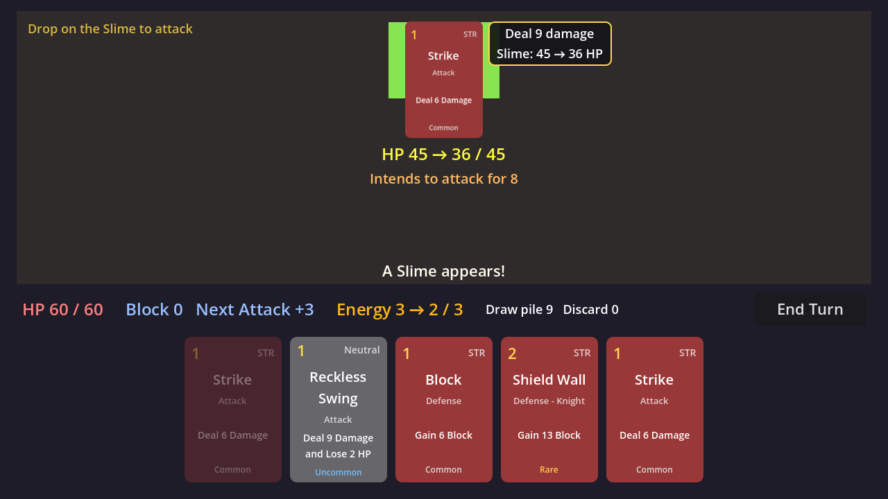
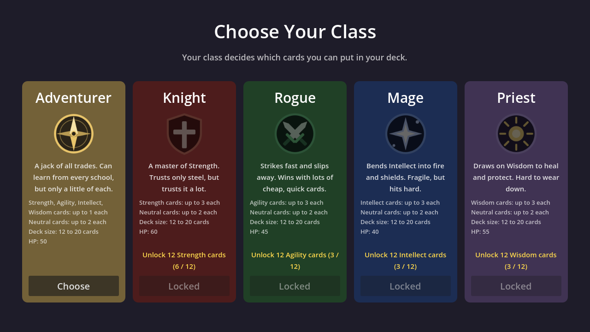
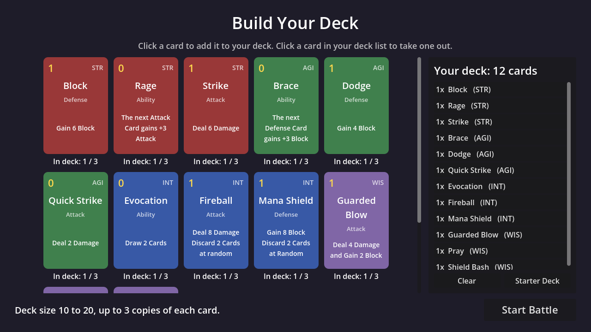

# Card Game

A tiny deckbuilder in the style of *Slay the Spire*, made with **Godot 4.7** and
**GDScript**. It's deliberately small so every line can be read and understood.







**What's in it so far**

- A **Character Select** screen: each class (Adventurer, Knight) has its own deck-building rules
- A **deck builder** before each battle: pick which cards (and how many copies) go in your deck
- 22 cards: four schools (Strength, Agility, Intellect, Wisdom), Neutral cards, and class-only cards, made from a
  spreadsheet: `data/cards.csv` (see [Making cards from the spreadsheet](#making-cards-from-the-spreadsheet))
- Draw 5 cards each turn, with a draw pile and discard pile that reshuffles when empty
- 3 **energy** per turn; cards you can't afford are greyed out
- Fights against one or several enemies (Slimes and Slimelings), each showing what it **intends** to do next turn
- Block that soaks up damage and disappears at the start of your next turn
- A turn loop (your turn, then the enemy's), plus a Victory / Defeat screen with Play Again and Change Deck buttons

---

## 1. Get the code onto your computer

Pick **one** of these. GitHub Desktop is recommended because it makes it easy
to get updates and save your own changes later.

### Option A: GitHub Desktop (recommended)

1. Download and install [GitHub Desktop](https://desktop.github.com/), then sign in with your GitHub account.
2. Choose **File → Clone repository...**
3. On the **GitHub.com** tab, pick `DustyOBrien/card-game`.
4. Leave the **Local path** as it is (usually `Documents\GitHub\card-game`) and click **Clone**.

Later, whenever new code is added on GitHub, click **Fetch origin** and then
**Pull origin** in GitHub Desktop to download it.

### Option B: Download ZIP (quickest, no extra software)

1. Go to the repo page on GitHub.
2. Click the green **Code** button, then **Download ZIP**.
3. Right-click the downloaded ZIP and choose **Extract All...**. Put the folder somewhere easy, like `Documents\card-game`.

With this option you won't get updates automatically; you'd download a fresh ZIP each time.

## 2. Open it in Godot

1. Start Godot. You'll see the **Project Manager** (the list of projects).
2. Click **Import**.
3. Browse to the `card-game` folder and select the `project.godot` file inside it.
4. Click **Import** (or **Import & Edit**). The editor opens.
5. Press **F5** (or the ▶ Play button at the top right) to play.

The first time you open the project, Godot creates a hidden `.godot` folder.
That's a cache that Godot can always rebuild, so it isn't saved to GitHub
(see `.gitignore`).

## 3. How to play

The game starts on **Character Select**. Your class decides which cards you can use:

Every class can use **up to 3 copies of any card**. What changes is the class's
deck rule:

| Class | HP | Can use | Extra rule | Unlocks when |
|---|---|---|---|---|
| Adventurer | 25 | Every school, Neutral, Adventurer cards | **Only 1 card from each school** in the whole deck (Neutral cards don't count) | Unlocked from the start |
| Knight | 30 | Strength, Neutral, Knight cards | - | You own 12 different Strength cards |
| Rogue | 22 | Agility, Neutral, Rogue cards | - | You own 12 different Agility cards |
| Mage | 20 | Intellect, Neutral, Mage cards | - | You own 12 different Intellect cards |
| Priest | 28 | Wisdom, Neutral, Priest cards | - | You own 12 different Wisdom cards |

Every deck needs 12 to 20 cards. A class's unlock counts the different cards
of that school you **own** (see "Your card collection" below). A locked class shows its progress, e.g.
"Unlock 12 Strength cards (6 / 12)". In the deck builder, the line under
**Your deck** counts your cards per school (`STR 3   AGI 2 ...`).

Class-only cards say so on their type line, e.g. **Attack - Knight**.

Then you're on the **deck builder**, holding your class's starter deck:

- Click a card on the left to add a copy to your deck. Click a row in **Your Deck** on the right to take one copy out.
- The dots under each card are its copies: **gold** = in your deck, **grey** = owned but not in it, **hollow** = not owned yet. The line under them shows the card's level and Exp, or why you can't add it ("Deck is full", "1 Strength card max").
- The tabs at the top right (**All 8**, **Strength 0**...) show one school at a time, with how many of your cards are in each. **Sort by** orders the cards by School, Cost, Name or Rarity.
- Your class's level and Exp bar are under its name.
- **Your Deck** shows a size bar (red until the deck is big enough), your cards per school, a **cost curve** (how many cards cost 0, 1, 2 and 3+), and how many Attack / Defense / Ability cards you have.
- **Clear** empties the deck; **Starter Deck** puts back the suggested deck (each card times its Copies number, but never more than your class allows).
- When the deck is big enough, click **To the Map**. **Change Class** goes back to Character Select.

**The map.** Pick where your run happens. The **Plains** are open; the
**Forest** and **Cave** are locked for now (greyed out with a padlock). Point
at an area to read about it, and click the Plains to start a run there.
**Edit Deck** goes back to the deck builder.

Cards show **symbols** instead of rules text, so you can read them at a glance:

| Symbol | Means |
|---|---|
|  sword | Damage to the enemy: a number or dice. `d3 x2` = two hits of d3 |
|  shield | Block you gain |
|  card + arrow | Cards you draw |
|  card + cross | Random cards you discard from your hand |
|  heart | HP you heal |

Effects without a symbol (Rage's "Next Attack +3", "+1 Energy", "Lose 2 HP"...)
are still written as a few words. The spreadsheet's Description column is
still used for the tooltip on rows in **Your Deck**.

In the battle:

- Point at a card in your hand to zoom in on it.
- **Drag** a card up out of your hand and let go above it to play it. With one enemy, attacks can be dropped anywhere above your hand too: the enemy lights up to show it will be hit. With several, drop an attack on the enemy you want to hit (see below). It costs energy (the yellow number in its corner).
- While you drag, a banner over the card says what it will do (with bonuses like Rage counted), and the numbers it would change turn gold. Let go over your hand to change your mind.
- The enemy has a **health bar** (its Block shows as a blue shield on the left). While you drag an attack, the bar shows the damage: the **bright, blinking** part is HP it will surely take, and the **striped** part is HP it might take, depending on the dice (`20 → 14–19`). When a hit lands, the lost part flashes yellow and shrinks away.
- **Cards roll dice** for their Attack, Block and Heal (`d3`, `d6`...), and they roll **when you draw them**: cards are dealt one at a time and their little dice tumble right on the card, then stay there so you can plan your turn. A d3 is a triangle and a d6 a square, and a gold die is a Critical (a bonus like Master of None's +1 lights up the dice it turns into crits). When you play the card, the **dice tray** on the left shows the roll with its bonus and total. The dice stay up until your next card or End Turn.
- **Wild** cards (marked *Wild* at the bottom) are the gamble: they DON'T roll when drawn. Their dice tumble in the dice tray when you play them, so you don't know what you'll get. The drag banner shows their range (`Deal 1–6 damage`).
- The **Battle Log** on the right lists everything that happens: each turn, the cards you draw and play, every roll, damage, Block and Heal. **Copy** puts the whole log on your clipboard, handy for pasting a game into a note when you test cards.
- **Advantage / Disadvantage:** roll each die twice and keep the higher (Advantage) or the lower (Disadvantage). The dice tray shows the die that was thrown away, small and faded. Having both cancels out. Insight gives your next roll Advantage; if that card already rolled when you drew it, it rolls a second set when you play it and keeps the higher dice.
- **Gamble** asks you to click a card in your hand (one that already rolled, not a Wild one) and rolls its dice again.
- **Criticals:** a die that lands on its top number (a 3 on a d3, a 6 on a d6) is a **Critical**, and the card's Crit effect happens (e.g. "Crit: Draw 1"). Bonuses count: with Master of None's +1, a 2 on a d3 becomes 3, which is a crit. Every die checks on its own, so Multi Strike (two d3s) can crit twice.
- **Armor** saves leftover Block, and it's part of your class (the Adventurer has 3). Normally your Block drops to 0 at the start of your turn. With Armor 3, up to 3 of it stays: gain 10 Block, take a 5 hit, and the 5 left over becomes 3 next turn (2 left over would stay 2). Armor never gives you Block on its own. It's shown next to your Block: `Block 5  (Armor 3)`. Change a class's Armor in its `.tres` file in `classes/`. Enemies can have Armor too: click an enemy in `enemies/` and set **Armor** in the Inspector (the Slime has 0).
- **Vanish** cards (marked *Vanish* at the bottom) disappear once you play them, for the rest of the run: they don't go to the discard pile, and they're left out of the next fights too. A new run brings them back. This stops healing cards from being played over and over.
- When you're out of energy or cards, click **End Turn**.
- **Several enemies:** a fight can have up to three enemies side by side, each with its own health bar and attack. To hit one with an attack, **drop the card on that enemy** (it lights up). With only one enemy left, you can drop attacks anywhere.
- **AoE and Random attacks:** a card's **Target** decides who it hits. **AoE** cards (marked *AoE*, like Sweep) hit **every** enemy, and **Random** cards send each hit to a random enemy. Drop them anywhere. While you drag, the health bars of the enemies it would hit show the damage.
- If a single-target card's first hit defeats its enemy (say Multi Strike), the next hits move on to another enemy.
- The enemies then attack, left to right, for the numbers shown under their names. Your Block absorbs damage first.
- Defeat every enemy to win. Each one drops **1 to 5 gold**.

**Runs and the shop.** A run is **5 fights in a row**, and your HP carries over
from one fight to the next (the top of the screen shows `Plains · Fight 2 / 5`).
In the Plains, the fights are: a Slime, 2 Slimelings, a Slime, a Slimeling and
a Slime, then 3 Slimelings. After a win, **Next Fight** starts the next one.
Win all 5, or die, and you go to the **Shop**:

- It shows how the run went and your gold.
- Buy a **Basic Booster** (5 gold). It waits under "Your packs" until you press **Open Pack**, which shows its 3 cards one by one, marked **NEW!**, "Owned 2 / 3", or "Extra! Owned 4" for copies past 3.
- Each card in a pack is **Common 60%, Uncommon 30%, Rare 10%**, picked from every card in the game (locked ones too), even ones you already own 3 of. (Pack odds: `PACK_ODDS` in `game_state.gd`. Price: `PACKS` in `shop.gd`.)
- **Start Next Run** goes to the map, to pick where the next run happens. It starts at full HP, and your unspent gold is kept (until you close the game).
- **Edit Deck** goes back to the deck builder first.

**Your card collection.** You start owning every card marked **Unlocked** in
the spreadsheet, as many copies as its **Copies** column (your starter deck);
every other card has to come from a booster pack. You can own up to **3** of a
card. The deck builder only shows cards you own, and a deck can't hold more
copies than you own (or than your class allows). The whole collection is shared
by every class. It lives in `GameState.collection`, and isn't saved when you
close the game yet.

**Card Exp.** Opening a card you already own 3 of gives that card **1 Exp**.
**3 Exp** makes it **Level 2**, and **5 more** (8 in total) makes it **Level 3**.
The level counts for every copy, and leveled cards say so ("Common · Lv 2").
What a level does comes from the level sheets (see "Card levels" below).
The numbers are `CARD_LEVEL_EXP` in `game_state.gd`.

**Class Exp.** Your class gets **10 Exp** for every enemy you beat and **25** more for
finishing a run. Level 2 needs 100 Exp, and each level after needs 50 more
(150, 200...), up to **level 25**. Each class levels up on its own, and leveling
up is how a class gets its **class cards** (see "Class cards" below). The Exp bar
fills up on the victory screen and shows on Character Select and in the deck
builder. The numbers are at the top of `game_state.gd` (`EXP_PER_ENEMY`,
`EXP_PER_RUN`, `FIRST_LEVEL_EXP`, `LEVEL_EXP_STEP`, `CLASS_MAX_LEVEL`).

Gold amounts, the run length and pack prices live at the top of
`game_state.gd` (`GOLD_MIN`, `GOLD_MAX`, `FIGHTS_PER_RUN`) and in `PACKS` in `shop.gd`.

---

## How the project is organized

```
card-game/
├── project.godot        Project settings (name, window size, which scene starts first)
├── scenes/
│   ├── character_select.tscn The first screen: pick a class
│   ├── deck_builder.tscn Pick the cards for your deck
│   ├── map.tscn         Pick an area (Plains, Forest, Cave) to start a run
│   ├── battle.tscn      The fight: enemy, player stats, hand, End Turn button
│   ├── shop.tscn        Between runs: spend gold on booster packs
│   └── card.tscn        What ONE card looks like
├── scripts/
│   ├── game_state.gd    Autoload: keeps your class, deck, gold and run while scenes change
│   ├── character_class.gd Defines what a class is (its deck rules)
│   ├── character_select.gd Shows one panel per class
│   ├── area.gd          Defines what an area is (name, picture, background, map spot)
│   ├── map.gd           Puts a button on the map for every area
│   ├── deck_builder.gd  Adding and removing cards, filters, deck stats
│   ├── battle.gd        The rules: drawing, energy, turns, winning and losing
│   ├── card.gd          Makes a card show its data; clicked (deck builder) or dragged (battle)
│   ├── play_zone.gd     The area above your hand where you drop cards to play them
│   ├── card_data.gd     Defines what information a card has (name, cost, damage...)
│   ├── combatant.gd     HP and Block for the player and the enemy
│   ├── dice.gd          Reads dice formulas like "2d6+1" and rolls them
│   ├── card_roller.gd   The dice rules: modifiers, crits, hits, totals
│   ├── die_view.gd      One die on screen, drawn with code (_draw)
│   ├── health_bar.gd    The enemy's health bar and damage preview, drawn with code
│   ├── dice_tray.gd     The panel where dice tumble and land
│   ├── battle_log.gd    The Battle Log panel (a RichTextLabel)
│   ├── shop.gd          The shop: pack list, buying, starting the next run
│   └── card_importer.gd Turns the spreadsheet into card files
├── tools/
│   └── import_cards.gd  Run this in the editor to re-import the spreadsheet
├── data/
│   └── cards.csv        The card spreadsheet (the master list of cards)
├── cards/               One .tres file per card, made by the importer
├── classes/             One .tres file per class (adventurer, knight, rogue, mage, priest)
├── areas/               One .tres file per area on the map (plains, forest, cave), with its fights
├── enemies/             One .tres file per kind of enemy (slime, slimeling)
├── art/                 Pictures (SVG): backgrounds/, enemies/ (Slime, Slimeling), areas/ (map icons), map/
├── emblems/             The class emblems (SVG pictures)
├── icons/               Card symbols: attack, block, draw, discard, heal (SVG)
├── themes/              main_theme.tres: how buttons and panels look everywhere
└── docs/                Pictures for this README (Godot ignores this folder)
```

You may also see `.uid` and `.import` files. Godot makes these automatically
to keep track of files. Leave them alone and keep them in git.

## The four big ideas in Godot

### Nodes

A **node** is one building block that does one job. A `Label` shows text. A
`Button` can be clicked. An `HBoxContainer` lines up its children side by side.
A plain `Node` does nothing on its own, but you can give it a script.

Nodes are arranged in a **tree**: each node can have children. Open
`scenes/battle.tscn` and look at the **Scene** panel (top left) to see it:

```
Battle (Control)                 ← battle.gd is attached here
├── Player (Node)                ← combatant.gd: your HP and Block
├── Background (ColorRect)        ← plain colour, in case an area has no picture
├── AreaBackground (TextureRect)  ← the area's picture (the Plains)
├── Margin (MarginContainer)
│   └── Layout (VBoxContainer)   ← stacks everything top to bottom
│       ├── EnemyBox             ← "Plains · Fight 2 / 5", then EnemyRow: one
│       │                          EnemyView (enemy_view.gd) per enemy, made in code
│       ├── Spacer
│       ├── MessageLabel
│       ├── PlayerBar            ← HP, Block, Energy, piles, End Turn
│       └── Hand (HBoxContainer) ← cards get added here while playing
└── GameOverScreen               ← hidden until someone wins
```

### Scenes

A **scene** is a tree of nodes saved as a file (`.tscn`). Scenes can be used
inside other scenes, like a blueprint you can stamp out many times.

`card.tscn` is the blueprint for a single card. The battle script makes a
new copy of it for every card in your hand:

```gdscript
var card: Card = CARD_SCENE.instantiate()  # build a new card from the blueprint
hand_box.add_child(card)                   # put it in the Hand row
```

Double-click `card.tscn` in the **FileSystem** panel (bottom left) to open
and edit it on its own.

### Scripts

A **script** (`.gd` file) adds behaviour to a node. The first lines say what
kind of node it's for, e.g. `extends Button`. That's like inheriting from a
class in Python: the script *is* a Button, plus whatever we add.

Godot calls some functions for you automatically. The main one here is
`_ready()`, which runs once when the node appears. It's a lot like Python's
`__init__`.

### Signals

A **signal** is an announcement: "something just happened". Other nodes
**connect** a function to it, and that function runs every time the signal
is **emitted**. The node making the announcement doesn't need to know who's
listening.

This project uses signals in a chain when you play a card:

1. You drag a card and drop it on the play zone (see "Drag and drop" below).
2. `play_zone.gd` emits its `card_dropped` signal, passing along which card it is.
3. `battle.gd` hears `card_dropped`, spends energy, and calls `enemy.take_damage(6)`.
4. `combatant.gd` lowers HP and emits `stats_changed`.
5. `battle.gd` hears `stats_changed` and updates the labels on screen.

Connecting in code looks like this (from `battle.gd`):

```gdscript
player.died.connect(_on_player_died)   # "when the player dies, run _on_player_died"
```

You can also connect signals without code, in the editor's **Node** tab (next
to the Inspector). This project connects them in code so you can see them all
in one place.

### Drag and drop

Godot has drag and drop built into every Control. It's three functions:

| Function | Lives on | Godot asks |
|---|---|---|
| `_get_drag_data()` | the thing you drag (`card.gd`) | "What are you carrying?" Return `null` to refuse (e.g. you can't afford the card). |
| `_can_drop_data()` | the place you drop (`play_zone.gd`) | "Would you take this, if it were dropped right here?" Cards that deal damage only say yes over the enemy. |
| `_drop_data()` | the place you drop (`play_zone.gd`) | "Here it is!" |

`set_drag_preview()` picks what follows the mouse. Ours is a copy of the card
(`duplicate()`) with a banner on top. Every node also gets
`NOTIFICATION_DRAG_BEGIN` and `NOTIFICATION_DRAG_END`, which `battle.gd` uses
to show "Drop here to play" and the gold preview numbers.

The preview and the real thing use the same functions (`get_damage()`,
`get_block()`), so the preview can't disagree with what actually happens.

### Switching scenes, and autoloads

The game has two screens, and each one is its own scene. Moving between them is one line:

```gdscript
get_tree().change_scene_to_file("res://scenes/battle.tscn")
```

That throws the current scene away (and every variable in it!) and loads the
new one. So how does the battle know which deck you built? It's kept in an
**autoload**: a script Godot creates once when the game starts and never throws
away. This project has one, `game_state.gd`, registered under the name
`GameState` in **Project → Project Settings → Globals → Autoload**. Any script
can use it by name:

```gdscript
GameState.deck.append(card)              # deck builder: add a card
draw_pile = GameState.deck.duplicate()   # battle: copy the deck, then shuffle the copy
```

Keep autoloads small: only things that really must outlive a scene belong there
(later: the player's HP between fights, gold, which floor you're on...).

### Themes: one look for every screen

Instead of styling every button by hand, the project has a **Theme**:
`themes/main_theme.tres`. It says what every `Button`, `PanelContainer`,
`ProgressBar` and scrollbar looks like (colours, rounded corners, borders), and
it's switched on for the whole game in **Project Settings → GUI → Theme → Custom**.
Double-click it in the FileSystem panel to open the **Theme editor** and try
changing a colour: every screen updates at once.

A theme can also have **variations**. `PrimaryButton` is a gold version of
`Button`; the deck builder's **To the Map** button uses it by setting
`theme_type_variation` to `PrimaryButton` in the Inspector.

### Bonus idea: Resources and card data

`card_data.gd` defines a **Resource**, which is Godot's name for a piece of
data saved as a file. Each file in `cards/` (like `strike.tres`) is one of them. Click
one in the FileSystem panel and you can change its cost, damage, or colour in
the **Inspector** on the right. (Changes made there are overwritten the next time you import the spreadsheet, so the spreadsheet is the place for lasting changes.)

Every card has these fields:

| Field | What it is |
|---|---|
| Card Name | The name at the top of the card |
| Cost | Energy needed to play it |
| Types | Checkboxes: **Attack** (deals damage), **Defense** (gains Block), **Ability** (other effects, like drawing a card). A card can have several. |
| Schools | Checkboxes: **Strength**, **Agility**, **Intellect**, **Wisdom**. A card can have several, or none (Neutral). Shown as STR / AGI / INT / WIS for now. |
| Attack | A list with one entry per hit, each a number or dice: `["d3", "d3"]` = Multi Strike |
| Attack Modifier | Added to every attack die (d3 + 1) |
| Block | Block the player gains: a number or dice |
| Block Modifier | Added to the block roll |
| Heal | HP the player gets back (can't go above max HP): a number or dice |
| Next Roll Bonus | Added to every die of the next card that rolls (Master of None) |
| Critical | What a Critical does, e.g. `+1 Damage` or `Draw 1, Gain 1 Energy` |
| Draw | Cards the player draws |
| Discard | Random cards thrown from the player's hand into the discard pile |
| Draw If Full HP | Cards drawn only if you were at full HP when you played it (Pray) |
| Next Attack Bonus | Extra damage for your next Attack card (Rage) |
| Next Defense Bonus | Extra Block for your next Defense card (Brace) |
| Copies | How many go in the Starter Deck (a class may allow fewer) |
| Class Only | Which classes may use it, e.g. Knight. Empty = every class |
| Rarity | Common, Uncommon or Rare. Shown at the bottom of the card (grey, blue, gold) |
| Unlocked | Off = the deck builder shows the card as **Locked** and you can't add it |
| Energy | Energy you gain when you play it (Adrenaline) |
| Lose HP | HP you lose when you play it. Block doesn't stop it (Reckless Swing) |
| Wild | On = its dice roll when you play it, not when you draw it |
| AoE / Random | Its attack hits every enemy / a random enemy (the Target column) |
| Vanish | On = gone for the rest of the run once played |
| Effect | The rules text printed on the card (typed by hand) |
| Color | The card's background colour |

Types and Schools use **bit flags**: each option is a power of two (1, 2, 4, 8)
and the card stores them added together, so Attack + Ability is 1 + 4 = 5.
The comments in `card_data.gd` explain this, and the helpers
`has_type()` / `has_school()` do the checking for you:

```gdscript
if card.has_type(CardData.CardType.ATTACK):
	print("This card is an attack!")
```

## How a turn works (in `battle.gd`)

```
start_battle()
  └─ copy the deck you built (GameState.deck), shuffle, then start_player_turn()

start_player_turn()
  ├─ the player's Armor saves up to that much leftover Block, refill energy to 3
  ├─ choose the enemy's next attack (shown as its "intent")
  └─ await draw_cards(5): deal cards one by one, dice cards (not Wild) roll

You drag a card onto the play zone  →  _on_card_played()
  └─ pay energy, roll (Wild) and show the dice, deal damage / gain block,
     then move the card to the discard pile (or Vanish it)

You click End Turn  →  _on_end_turn_pressed()
  ├─ move the rest of your hand to the discard pile
  ├─ enemy_turn(): short pause, then the enemy attacks
  └─ start_player_turn() again (unless someone's HP hit 0)
```

## GDScript for Python people

| Python                       | GDScript                              |
|------------------------------|---------------------------------------|
| `def attack(amount):`        | `func attack(amount: int) -> void:`   |
| `x = 5`                      | `var x := 5`                          |
| `MAX = 3` (by convention)    | `const MAX := 3`                      |
| `None`                       | `null`                                |
| `True` / `False`             | `true` / `false`                      |
| `for i in range(5):`         | `for i in 5:`                         |
| `len(my_list)`               | `my_list.size()`                      |
| `my_list.pop()`              | `my_list.pop_back()`                  |
| `random.shuffle(my_list)`    | `my_list.shuffle()`                   |
| `f"HP {hp}/{max_hp}"`        | `"HP %d / %d" % [hp, max_hp]`         |
| `self.hp`                    | `hp` (`self.` is optional)            |
| `import` a class             | `class_name` makes it available everywhere |

Indentation works just like in Python (this project uses tabs). The `: int`
and `-> void` bits are optional type hints, like Python's. They help Godot
catch mistakes and autocomplete for you.

## Things to try next

Small changes, roughly easiest first:

1. **Tweak numbers.** Change a card's numbers in the spreadsheet and re-import, or the Slime's HP by clicking `enemies/slime.tres`.
2. **Change a class's deck rules.** Click `classes/knight.tres` in the FileSystem panel and change the numbers in the Inspector. Or make a new class (see [Adding a class](#adding-a-class)).
3. **Change an enemy's attacks.** Click it in `enemies/` and change **Attack Min** / **Attack Max**.
4. **Make a new card.** Add a row to the spreadsheet and re-import (see below).
5. **Show HP as a bar** using a `ProgressBar` node instead of a label.
6. **Give the enemy a second move**, like sometimes gaining Block instead of attacking.
7. **Add a card reward** after winning, so your deck grows: that's the "deckbuilding" part!

## Making cards from the spreadsheet

All cards live in one spreadsheet, `data/cards.csv`. The game doesn't read the
spreadsheet directly; an **importer** turns each row into a card file in `cards/`.

**To change cards:**

1. Edit your spreadsheet and export it as CSV (Google Sheets: **File → Download → Comma-separated values**).
2. Save it over `data/cards.csv` in the project folder (same name).
3. In Godot, double-click `tools/import_cards.gd`, then in the Script editor choose **File → Run** (Ctrl+Shift+X).
4. The **Output** panel at the bottom lists every card it made. Press F5 to play.

**Columns** (the order doesn't matter, and capital letters don't matter):

| Column | Example | Notes |
|---|---|---|
| Name | Multi Strike | Also used for the file name (`multi_strike.tres`) |
| Copies | 2 | How many go in the Starter Deck. A class can allow fewer: the Adventurer only ever gets 1 of a school card |
| Cost | 1 | |
| School | Neutral | Strength, Agility, Intellect, Wisdom or Neutral. Several allowed, separated by `,` or `/`. Blank = Neutral |
| Type | Attack | Attack, Defense, Ability. Several allowed, like School |
| Class | Adventurer | Only these classes can use the card. Several allowed, like School. Blank = every class |
| Rarity | Rare | Common, Uncommon or Rare. Blank = Common |
| Unlocked | TRUE | TRUE/FALSE or Yes/No. TRUE = you start owning it (as many as Copies). FALSE = you have to find it in a booster pack first (until then it's hidden in the deck builder). Blank = TRUE |
| Description | Deal d3x2 Damage | Hover text in the deck list. **Leave it blank** and it's written for you from the numbers |
| Attack | d3, d3 | A number (`6`) or dice: `d3` = one 3-sided die, `2d6+1` = two 6-sided dice plus 1. Several hits separated by commas: `d3, d3` = two hits, each rolled on its own (Multi Strike) |
| Attack (2) | d3 | A second hit, rolled separately. Attack (3), (4)... work too |
| Hits | 2 | Optional, instead of Attack (2): repeats the Attack this many times |
| Attack Modifier | 1 | Added to every attack die, and counts towards a crit (d3 + 1 crits on a 2 or a 3) |
| Block | d3 | A number or dice, like Attack |
| Block Modifier | 1 | Added to the block roll |
| Heal | d3 | A number or dice, like Attack |
| Heal Modifier | 1 | Added to the heal roll |
| Draw | 2 | Cards drawn |
| Discard | 1 | Random cards discarded from your hand |
| Draw If Full HP | 1 | Cards drawn if you were at full HP. TRUE counts as 1 |
| Next Die Roll Bonus | d3 | Added to every die of the next card you play that rolls. A number, or dice that roll when the card is played (Pump Up) |
| Next Attack Bonus | 3 | Added to every hit of your next Attack card (counts towards crits) |
| Next Defense Bonus | 3 | Added to your next Defense card's Block |
| Energy | 1 | Energy gained |
| Lose HP | 2 | HP lost (Block doesn't stop it) |
| Critical Effect | Draw 1 | What happens for each die that crits. Use these phrases, separated by commas: `+1 Damage`, `+1 Block`, `+1 Heal`, `Draw 1` (or `Draw a Card`), `Gain 1 Energy`, `Gain Advantage`, `Dont Vanish`. Blank or `-` = none. (A column called just **Critical** works too) |
| Wild | TRUE | TRUE = the dice roll when played, not when drawn. (Or a **Roll** column with `Play` / `Draw`.) Blank = FALSE |
| Vanish | TRUE | TRUE = gone for the rest of the run once played. Blank = FALSE |
| Advantage | TRUE | This card's dice roll with **Advantage**: each die is rolled twice and the higher one is kept |
| Disadvantage | TRUE | This card's dice roll with **Disadvantage**: each die is rolled twice and the lower one is kept (Wild Swing) |
| Target | All | Who an attack hits: **Single** (the enemy you drop it on), **All** (or **AoE**: every enemy) or **Random** (each hit picks a random enemy). Blank = Single |
| Gain Advantage | TRUE | The next card you play that rolls dice gets Advantage (Insight) |
| Reroll | 1 | After playing it, click this many cards in your hand to roll their dice again. Wild cards can't be picked (Gamble) |

Blank cells count as 0 (and FALSE). The "Card" column is ignored (Name is used instead).
If the importer can't read a cell (like a Critical it doesn't know), it prints a
warning in Godot's Output panel and skips that part.

**The spreadsheet is the boss:** any card file in `cards/` that isn't in the
spreadsheet gets deleted when you import. So make new cards by adding rows,
not by duplicating `.tres` files in Godot.

### Card levels: `cards_level2.csv` and `cards_level3.csv`

These two sheets have **exactly the same columns** as `cards.csv`. The easiest
way to make one: copy your card sheet, change the numbers, and save it as
`data/cards_level2.csv` (or `cards_level3.csv`). The **Name** says which card
a row levels up, so it must match a card in `cards.csv`. You only need rows for
cards that change: a card that isn't in the level 2 sheet plays like level 1.
(A level 3 card that isn't in the level 3 sheet uses its level 2 row.)

The importer saves them in `cards/levels/` (e.g. `strike_lv2.tres`). Battles
and the deck builder show the version that matches the card's level.

### Class cards: `class_cards.csv`

One row per card a class gets when it reaches a level:

| Class | Level | Card | Copies |
|---|---|---|---|
| Knight | 2 | Shield Bash | 1 |
| Knight | 5 | Shield Wall | 2 |

- **Class** is the class's name, **Card** is a card's Name from `cards.csv`.
- **Level 1** cards are given right at the start.
- **Copies** is optional (1 if blank). Copies past 3 turn into card Exp.
- Give class cards a **Class** in `cards.csv` (e.g. `Knight`) if only that class
  should use them, and **Unlocked = FALSE** so they don't start in the collection.
  Class cards never come out of booster packs.

The importer saves each class's list into its file in `classes/` (look for
**Level Cards** in the Inspector).

## Dice and Criticals

Three scripts share the work:

- **`dice.gd`** reads a formula. `Dice.parse("2d3+2")` gives 2 dice, 3 sides,
  +2 bonus, and `"6"` gives no dice and a bonus of 6. It uses a **RegEx** (a text
  pattern). Its functions are `static`: you call them on the class itself, like
  functions in a Python module.
- **`card_roller.gd`** is the rules. `CardRoller.roll(card)` rolls the bare dice,
  and `CardRoller.resolve(card, dice, bonuses)` adds the modifiers, checks every
  die for a crit (die + modifiers reaching its top number) and adds up the hits,
  Block, Heal, Draw and Energy. Keeping the rules in one place means the drag
  preview and the real play can never disagree: the preview simply resolves the
  card with every die on 1 (worst case) and every die on top (best case).
- **`battle.gd`** applies the result: one `take_damage()` per hit, Block, Heal,
  then any extra cards to draw.

The dice you see are drawn by **`die_view.gd`** with `_draw()`, Godot's way of
painting shapes and text with code (no picture files): `draw_colored_polygon()`
for the die, `draw_polyline()` for its edge, `draw_string()` for the number.
**`dice_tray.gd`** spins them with `rotation`, and a Tween with `TRANS_BACK`
gives the landing its little bounce. The small dice on cards in your hand are
the same `DieView`, made with `DieView.new(32)` for a 32 pixel die, and
`card.gd`'s `roll_dice()` tumbles them as the card is drawn.

Two Godot ideas show up in `battle.gd`:

- **`await`**: `await dice_tray.play(...)` pauses that function (not the
  whole game) until the dice animation finishes, then carries on and deals the
  damage. `await draw_cards(5)` waits for the cards to be dealt and their dice
  to land. While it waits, `busy` is true so you can't play another card.
- **`duplicate()`**: at the start of a battle every card in the deck is copied.
  Each copy remembers its own roll (`roll_result`), so two Strikes in your hand
  can show different numbers, and the card files on disk never change. Each
  copy is also tagged with `set_meta("deck_index", i)`, its place in your deck,
  so when it Vanishes, `GameState.vanished` knows exactly which card to leave
  out of the next fights.

## Adding a class

Classes are data, just like cards: each one is a `.tres` file in `classes/`,
made from `character_class.gd`. To add one, you don't write any code:

1. In the **FileSystem** panel, right-click `classes/knight.tres` and choose **Duplicate...**. Name it, e.g. `rogue.tres`.
2. Click the new file. In the **Inspector**, change:
   - **Display Name**, **Description**, **Color**, **Max HP**
   - **Emblem**: drag an image onto it from the FileSystem panel. The emblems are simple drawings in `emblems/` (SVG files, which you can edit in a free program like Inkscape, or swap for your own PNGs)
   - **Unlocking**: tick **Starts Unlocked**, or pick the **Unlock School** and **Unlock Card Count**
   - **Sort Order**: where it appears on Character Select (lower = further left)
   - **Deck Rules**: which **Allowed Schools** are ticked, **Allow Neutral**, **Max Copies** (school cards), **Max Copies Neutral**, **Max Cards Per School** (0 = no limit), **Min / Max Deck Size**
3. Press F5. The new class is on Character Select, and its rules text is written for you from those numbers.

To give the new class its own cards, type its **Display Name** in the **Class** column of the spreadsheet and re-import.

## Adding an area

Areas work like classes: one `.tres` file per area in `areas/`, made from
`area.gd`. To change one, click it and edit it in the **Inspector**:

- **Unlocked**: tick it to open the Forest or the Cave.
- **Icon**: the round picture on the map. **Background**: the picture behind the fight (the Forest and Cave don't have one yet, so they'd use the plain dark colour).
- **Map Position**: where its centre sits on the map, in pixels (the screen is 1280 × 720).
- **Sort Order**: its place along the road.

To add a new area, duplicate `areas/forest.tres`. The map draws a button for every area file it finds.

### Enemies and fights

Each kind of enemy is a `.tres` file in `enemies/` (made from `enemy_data.gd`):
its **Display Name**, **Max HP**, **Armor**, **Attack Min / Max**, picture
(**Texture**), **Sprite Size** and name colour. To add one, duplicate
`enemies/slime.tres` and change it in the Inspector.

Which enemies you meet is set on the **area**. Click `areas/plains.tres` and
open **Encounters** in the Inspector: it's a list with one entry per fight
(fight 1 = the first). Each entry has a list of **Enemies**, left to right.
Drag an enemy file from `enemies/` into a slot to use it. If an area has fewer
encounters than fights, the list starts over.

The pictures are in `art/enemies/`. In battle each enemy "breathes" with a
looping Tween (`set_loops()`), hops when it attacks, flashes red when hit, and
squishes flat when defeated. See `enemy_view.gd`.

## Saving your own changes to GitHub (GitHub Desktop)

1. Make changes in Godot and save (Ctrl+S).
2. In GitHub Desktop, you'll see the changed files on the left.
3. Type a short summary at the bottom left (e.g. "Make Strike deal 7 damage") and click **Commit to main**.
4. Click **Push origin** to upload it to GitHub.
